# Prompts

Every agent prompt in the harness, how each prompt is assembled, which model role runs it, and the tool contracts the prompts depend on. The design reasoning is in `docs/architecture.md`:
- §4.10: agents and session flow;
- §4.20: sections and plugins;
- §4.21: research;
- §4.22: model roles.

**Status.** The tutor (measure, teach, close), the planner, the researcher job and compaction are live: `crates/harness/build.rs` bundles every file here, `src/prompts.rs` composes them as described below, and a file at `<repo>/prompts/<same relative path>` overrides the bundled copy. `practice.md` still drives Practice mode on its own and is deleted when the coach lands. The coach, the other jobs and the native base plugins are the target set (`docs/agent-system-plan.md`, "Not built yet"); the plugin packages that exist today are in `plugins/` (authoring spec: `docs/plugins.md`).

## Principles

1. **One live agent per conversation with the learner.** The **tutor** measures and teaches in one conversation, so everything it learns while probing is there when it teaches. In practice sessions, the **coach** writes, hints and grades.
2. **The plan belongs to a separate planner.** The tutor can't write or edit the plan; it can only send a `plan_change_request` with evidence. The planner reads the whole conversation (so nothing is lost) and either revises the plan or keeps it. That keeps the approved route from drifting one explanation at a time.
3. **Research is a resource, not a gate.** `goal_set` starts a scope job in the background, and the tutor starts probing at once. The tutor and coach can call the researcher at any point. The only gate is that `probe_done` waits for the scope brief.
4. **Any other separate agent** exists only when separation itself improves the result:

| Reason | Agents |
|---|---|
| It must **not know** something the main agent knows | Problem checker: it reads the problem blind to the target, to test whether the wording gives the target away |
| It would **flood the conversation** with raw material | Researcher (search results, whole documents), demo builder (HTML + test loops), figure maker (SVG + renders) |
| Its **input isn't the conversation** | Graph builder (also processes imported files), topic splitter (works on one topic) |

Jobs never touch the conversation. They get their own small input, return one structured result, and end. Their result shows up as a message.

## Session flow

```mermaid
stateDiagram-v2
  [*] --> Measure
  state Measure {
    [*] --> Goal
    Goal --> Probe: goal_set (scope job starts in background)
    Probe --> Probe: brief arrives → re-aim; research any time
  }
  Measure --> Plan: probe_done (needs the brief)
  Plan --> AwaitApproval: planner plan_write
  AwaitApproval --> Plan: learner asks for changes
  AwaitApproval --> Teach: learner clicks Approve
  Teach --> Teach: section_done → next section (mode and plugins switch)
  Teach --> Plan: plan_change_request (tutor) or learner edits the map
  Plan --> Teach: plan_keep, or a minor change with a notice
  Plan --> AwaitApproval: goal changed or sections removed
  Teach --> Close: last section done
  Close --> [*]
  Close --> GraphBuilder: background
```

Measure, Teach and Close are the tutor's. Plan is the planner's.

## The agents

| Agent | Files | Talks to the learner | Runs | Model role | Ends with |
|---|---|---|---|---|---|
| **Tutor** | `tutor/base.md` + `tutor/phases/{measure,teach}.md` (+ `tutor/hunt.md` while a hunt is active) + `tutor/modes/<mode>.md` + the active plugins' `prompts/tutor.md` | yes | Whole teaching session, except planning | Tutor | `session_end` |
| **Planner** | `planner/base.md` (+ `planner/exam.md` when `purpose = exam`) | through the plan card | After `probe_done`; on a learner change request; on `plan_change_request` | Planner | `plan_write` or `plan_keep` |
| **Coach** | `coach/base.md` + the active plugins' `prompts/practice.md` | yes | Whole practice session | Tutor | `problem_conclude` per problem |
| Researcher | `jobs/researcher.md` | no | `scope` on `goal_set`; `verify`, `scope` and `source` on request from any agent | Reader | `brief_submit` |
| Problem checker | `jobs/problem-checker.md` | no | After each `problem_commit`: turn 1 blind, turn 2 told the target | Planner | `audit_submit`, `necessity_submit` |
| Graph builder | `jobs/graph-builder.md` | no | Over the teaching not yet extracted: after a tutor turn once 4,096 new tutor tokens have accumulated, after `session_end` for the rest, and on demand through `graph_build` (from 1,024) | Librarian | `graph_submit` |
| Topic splitter | `jobs/topic-splitter.md` | via a suggestion card | When a topic passes ~30 nodes | Librarian | `split_suggest` |
| Demo builder | `jobs/demo-builder.md` | no | On `demo_request` | Builder | `demo_submit` |
| Figure maker | `jobs/figure-maker.md` | no | On `figure_request` | Builder | `figure_submit` |

**Compaction is a turn, not an agent.** Once the conversation passes 20% of the context window, the live agent gets `compaction.md` as the instruction for one turn. The notes it writes replace the older turns. The turn runs on that agent's own role.

Things that are code, not agents:
- the scheduler;
- the phase machine and every gate (§4.10);
- grading of choice questions;
- environment checks;
- community detection for the topic splitter;
- the plan card's map layout.

## Model roles

The learner picks a model per role in Settings. The harness maps agents to roles. Only **Tutor** is required; every unset role falls back to the Tutor model.

| Role (Settings label) | Runs | Needs | Guidance text shown |
|---|---|---|---|
| **Tutor** · heavy · *talks with you* | tutor, coach, their compaction turns | tool calling; strong reasoning; ≥128k context | "Your best model. Learning quality depends on it most." |
| **Planner** · heavy · *thinks rarely, deeply* | planner, problem checker | tool calling; strongest reasoning; effort high by default | "Best reasoning model, high effort. Called rarely." |
| **Reader** · light · *searches and reads* | researcher, session titles | tool calling; long context (≥200k recommended); vision optional | "Fast, cheap, long context. Vision reads scans." |
| **Librarian** · medium · *keeps your knowledge graph* | graph builder, topic splitter | tool calling; reliable structured output | "Not the cheapest: its mistakes stay in your graph." |
| **Builder** · medium · *code and visuals* | demo builder, figure maker | tool calling; strong coding; vision for figures | "Good coding model. Figures need vision." |

## Composition

**Tutor system prompt**, in order:
1. `shared/voice.md`, `accuracy.md`, `learner-signals.md`, `questions.md`, `formatting.md`, `learner-files.md`, then `shared/workspace.md` when the session has an attached workspace.
2. `tutor/base.md`, with:
   - `{{session_state}}`: the pinned goal record, field brief, probe map, plan and current section, learner-model data, and platform, then a `## This device` section when this device lacks something: on mobile, the desktop-only plugins the session used (their tools and fragments are left out; `docs/sync-build.md`, "Sessions on mobile"), and on any device, a folder attached on another device ("The folder `<name>` is attached on another device; its files aren't available here.");
   - `{{phase}}`;
   - `{{phase_instructions}}`, filled from the phase file.
3. Inside the phase file:
   - **measure:** `{{active_plugins}}` is empty today. Measure-phase plugins from the scope brief are a target, not built.
   - **teach:** the section header fields (including `section.notes`, written by the planner), `{{mode}}` from `tutor/modes/<section.mode>.md`, and `{{active_plugins}}` from the section's active **plugin packages** (each package's `prompts/tutor.md`) plus any granted mid-section. Learning-system flags add more (see below): `section.targetLevel`, `section.learnerNote`, `section.knownNote` (with `known_section`), and `{{hunt}}` = the body of `tutor/hunt.md` with `{{hunt.state}}` filled (with `hunt_active`).

**Planner system prompt:**
1. `shared/accuracy.md`, `learner-signals.md`, `learner-files.md`.
2. `planner/base.md` with `{{session_state}}`, `{{plugin_catalog}}` (one manifest line per installed, enabled plugin available on the platform) and `{{exam_mode}}` (`planner/exam.md` or empty).

Its **messages** are the session conversation (the same messages the tutor sees, compacted the same way), followed by the request it is answering: the initial plan, a learner change request, or a `plan_change_request`.

**Coach system prompt (target):** `shared/voice.md`, `accuracy.md`, `learner-signals.md`, `formatting.md`, then `coach/base.md` with `{{session_state}}`, then the fragments of the plugins active when the targets were taught. Practice mode today is `practice.md` alone, with no tools.

**Jobs:** their own file, with `{{task}}` and the other placeholders filled from the job record.

**Caching.** Shared fragments and agent bases come first and never change within a session, so providers that cache by prefix keep them. Phase and section parts change only at phase changes, section boundaries, plan revisions and plugin grants, never turn by turn.

Fragments wrapped in `{{#flag}} … {{/flag}}` are included only when the flag is set; an unset flag drops the block without error, and placeholders inside a dropped block are never required.

| Flag | Set when | Design |
|---|---|---|
| `mermaid` | every tutor compose (set in `agent.rs` next to `workspace`): the UI renders Mermaid. The planner never sets it (its text has no Mermaid); Practice renders `practice.md` through the same composer with no flags, so its `{{#workspace}}` block is dropped (Practice has no workspace tools) | arch §4.24 |
| `workspace` | per tutor compose: the session has an attached workspace folder (adds `shared/workspace.md`, fills `{{workspace_name}}`) | arch §4.25 |
| `levels` | target levels are built | `docs/learning-system.md` §2 |
| `starting_point` | the starting-point setting is built: `tutor/phases/measure.md` asks for it, and `planner/base.md` starts `unprobed`/`new` strands at the field's roots | §3 |
| `plan_controls` | plan-card controls and known sections are built | §4 |
| `known_section` | `plan_controls` is on **and** the current section has `assumedKnown: true` (per compose) | §4 |
| `hunts` | hunts, debriefs, heuristics and the frontier are built | §5 |
| `hunt_active` | `hunts` is on **and** the current section's hunt is enabled and not skipped (per compose) | §5 |
| `field_guide` | discourse and venues in briefs, plus the close guide, are built | §6 |
| `calibration` | the calibration summary is built | §7 |

The learning-system flags gate **behavior** (what the model is told to do). Turn each one on in the same change that builds its code and session-state fields. With all of them off, the prompts compose as they did before these features were written.

**What they add besides text.** Flags also gate data inside `{{session_state}}`: with `levels` the probe map carries each strand's `levelReached` and plan lines carry `aim: <level>`; with `plan_controls` and `hunts` those lines also carry `known` and `hunt: <state>`, and the goal and plan records carry `depth`, `explore`, `startingPoint`, `minutesPerSitting` and `style`; with `field_guide` a `## Field guide` block lists each venue as `kind  name — useful now` or `— useful once you hold: <entryLevel>`, and each strand in the brief carries `discourse`; with `calibration` a `## Calibration` block gives the buckets and the notes sentences, both written by code.

**New placeholders.** All are always set, so a block that is dropped never has to be supplied: `section.targetLevel` (`(none)` when the section has none), `section.knownNote` and `section.learnerNote` (empty strings when the learner wrote none), and `hunt` with `hunt.state` — `tutor/hunt.md` is not composed on its own. The tutor gets it pre-rendered with `hunt.state` (`ready` | `out` | `returned` | `skipped`) and inserts it at `{{#hunt_active}}{{hunt}}{{/hunt_active}}`; the planner gets the same value so a prompt that mentions it never fails to render.

## Tool contracts

Tools are scoped by agent and phase. A tool that is absent is never described to the model.

| Tool | Who / phase | Arguments → result |
|---|---|---|
| `choice_ask` | tutor (all phases) | `{ question, options[], recommended? }` → a choice or free text |
| `question_ask` | tutor: measure (`probe`), teach (`predict`, `check`) | `{ role, nodeId?, strand?, format: free \| choice, prompt, options?, answer, explanation?, view? }` → `{ questionId, answer, thinking, thinkingWhileReading?, confidence?, dontKnow, verdict? }`. `questionId` is the id `verdict_record` and `probe_done.evidence` use. In teach, `nodeId` must be in the current section. With `levels`: `level: explain \| use \| analyze \| design`, in every phase schema's `required` list; the gate refuses a `probe` or `check` without one. `view: { artifactId, task, target }` makes an artifact's view the answer surface: refused unless `task` is non-empty, `target` is an object, the artifact is in this session, its plugin is installed **and enabled**, lists this device's platform, and its view has `answer = true`. `target` is the grading target, committed in the call op and never shown. A view question's result is `{ questionId, artifactId, answer, view }`: `answer` is what the view submitted, `view` the plugin's `grade` result (`{ correct, detail }`); `verdict_record` is still yours |
| `verdict_record` | tutor: measure, teach | `{ questionId, verdict: correct \| partial \| wrong, note }` |
| `workspace_write` | tutor: teach, only when a workspace is attached | `{ path, content }` → `Wrote <path> (<n> bytes) in the workspace. The learner may edit it in their own editor; re-read before relying on it.` `path` is relative to the workspace; folders are created; nothing is ever deleted; text only (binary extensions refused), ≤ 256 KiB; an existing file is overwritten only when its sha256 matches your last `file_read` or `workspace_write` of it, otherwise the error tells you to `file_read` first. Called on a device with no folder for the session (e.g. one attached on another device): refused with "no workspace is attached to this session" |
| `research_request` | tutor, coach (all phases) | `{ kind: verify \| scope, question, context }` or `{ kind: source, path, question }` → ack; the brief arrives as a message. Several can run at once |
| `research` | planner | Same arguments; **blocks** and returns the brief as the tool result |
| `file_find`, `file_read` | tutor, planner, coach | Read-only access to the learner's files: `file_find { pattern }` (name fragment or glob) → paths; `file_read { path, lines? }` → text (≤ 256 KiB), or a PDF's pages tagged `[p.3] …` (a scan's page says it has no text layer) |
| `graph_search` | tutor, planner, graph builder | `{ query, scope: nodes \| topics }` (absent until the graph exists) |
| `goal_set` | tutor: measure | See `tutor/phases/measure.md`; starts the `scope` job. With `levels`: purpose adds `course`, `depth: pass \| solid \| deep` (default `solid`); with `hunts`: `explore: off \| suggest \| on` (default `off`, forced `off` for `course`/`exam`); with `starting_point`: `startingPoint: measure \| quick \| new` (falls back to the device setting, else `measure`) |
| `probe_done` | tutor: measure | See `measure.md`; refused while a question is open or before the scope brief has arrived. On success the planner runs. With `levels`: each strand carries `levelReached: none \| explain \| use \| analyze \| design`. With `starting_point`: zero probe questions allowed for `new` (strands `unprobed` with `reason: "new"`), at most five for `quick` (`reason: "skipped"` for the rest) |
| `plan_write` | planner | See `planner/base.md`. A section's `plugins` may name a plugin that isn't installed only if a cached registry index lists it; code then sets that section's `needsInstall` (the model cannot). Learning-system section fields: `targetLevel`, `assumedKnown`, `knownNote`, `learnerNote`, `hunt { available, reason }`; refused if `hunt.enabled` is set, or `hunt.available` while explore is `off` |
| `plan_keep` | planner | `{ reason }`; answers a change request without changing the plan |
| `plan_ask` | planner (with `plan_controls`) | `{ question, options[] }`; one question on the plan card, with the learner free to write their own answer. Calling it **ends the planner run** without a delivered notice; `answer_plan_question` starts a fresh run with the answer |
| `plan_change_request` | tutor: teach | `{ reason: learner \| missing-foundation \| ahead \| detour \| probe-wrong, evidence, learnerWords? }` → ack; the planner's answer arrives as a message |
| `plugin_request` | tutor: teach | `{ plugin, reason }` → granted, "already active", or refused (unknown, not installed/enabled, not on this platform, section limit of three) |
| `plugin_search` | planner | `{ query }` → JSON array of up to five uninstalled matches (every whitespace-separated term must appear in id, title, description or use_when; only entries listing this device's platform) from the configured registries' cached indexes: `id`, `title`, `description`, `useWhen`, `avoidWhen`, `platforms`, `permissions`, `version`, `registry`; or a one-line "no plugin matches" message. Read-only; never fetches; installing is the learner's action |
| `section_done` | tutor: teach | `{ sectionId, evidence, carryOver }`; refused while a section node lacks a passing check. With `levels`: also needs one passing check at `level ≥ targetLevel`. A known section closes on one passing check at its target level |
| `session_end` | tutor: teach, close | `{}`. After the last `section_done` the phase is Close and the tutor writes the close, then calls it |
| `hunt_send` | tutor: teach | `{ sectionId, question, lookAt: [{ kind: forum \| datasheet \| lecture \| video \| paper \| docs \| person, venue?, why }], bringBack: [string] }`; `huntId` is the call id. Refused unless the current section's hunt is available, enabled, not skipped, and has had no `huntSend` yet. Listed in every Teach turn; what the model is *told* about hunts arrives only with `hunt_active` |
| `debrief_record` | tutor: teach | `{ huntId, claims: [{ claim, source?, verdict: correct \| partial \| wrong \| tip \| offroute, note, attribution?, scope? }] }`; refused without a `huntReturn` for that `huntId`; teaching questions in a hunted section are refused until it's recorded. Listed in every Teach turn, described with `hunt_active` |
| `frontier_park` | tutor: all phases | `{ topic, why }` → appends `{ op: "frontier", opId, at, topic, why, from: { sessionId, huntId? } }` to `<repo>/frontier.jsonl` (created on first use). Listed in every phase; its instructions reach the model with `hunts` |
| `problem_commit`, `problem_conclude` | coach | See `coach/base.md` |
| `audit_submit`, `necessity_submit` | problem checker | See `jobs/problem-checker.md` |
| `web_search`, `page_fetch`, `source_outline`, `source_search`, `source_read`, `source_page_image`, `brief_submit` | researcher | See `jobs/researcher.md`; search via `crates/research-search` (Brave → Wikipedia); `page_fetch` returns a PDF's page-tagged text, and `source_page_image { path \| url, page }` attaches one scanned page's image (≤ 4 per run) |
| `message_read` | graph builder | `{ index }` → one message of the prompt's numbered list, whole (`<who>:\n<text>`); an index outside the list is refused with the valid range |
| `graph_search` | graph builder | `{ query }` → up to 20 graph nodes and topics matching the query, with ids, titles and homes. Read-only |
| `graph_submit` | graph builder | See `jobs/graph-builder.md` |
| `split_suggest` | topic splitter | See `jobs/topic-splitter.md` |
| `demo_test`, `demo_submit` / `figure_render`, `figure_submit` | demo builder / figure maker | See their files |

## Plugins

A plugin is a **package**, not a prompt file: `plugin.toml` (manifest), `src/*.luau` (tools), `schemas/*.json`, optional `views/*`, required `tests/*.luau`, and `prompts/<agent>.md` — one Markdown fragment per agent allowed to use the plugin. Full authoring reference: **`docs/plugins.md`**. Packages live in `plugins/` in this repo (the reference `circuit`) or are installed from a registry; they are read from disk, not bundled by `build.rs`, so a learner's prompt override cannot replace a plugin fragment. The old `prompts/plugins/*.md` manifest convention and its loader are removed; nothing in this folder describes a plugin any more.

What the prompts depend on:

- **Catalog lines.** The planner sees one line per installed, enabled, platform-available plugin: title, id, tool names, platforms, `use_when`, `avoid_when`, `cost`.
- **Fragments.** While a plugin is active in the current section, the tutor gets its `prompts/tutor.md` in `{{active_plugins}}` in Teach and Close (Coach's `prompts/practice.md` when the coach lands). Nothing from an inactive, disabled or missing plugin reaches a prompt.
- **Tools.** In Teach, the active plugins' tools scoped to `tutor` are added to the tool list with the manifest's names and JSON Schemas. A tool name starts with `<id>_` (dashes → underscores), e.g. `circuit_draw`. A plugin error comes back as a tool error starting `plugin error:`; result text is capped at 16 KiB. The call op records the plugin's id and `platforms`. On mobile, a call to a plugin known not to run there is refused with "`<id>` only runs on desktop; teach without it", and the session locks on that device after the turn unless the learner already chose "Continue here anyway" (`docs/sync-build.md`, "Sessions on mobile").
- **Artifact handles.** A tool declared `artifact = true` stores its figure as an `artifact` op (with the plugin's `platforms`) and its result ends with one line: `artifact: <id> — place it once with  next to the sentence that refers to it`. The model places it with that Markdown image syntax; `shared/formatting.md` carries the placement rule. An unplaced artifact is appended after the turn's message. A `question_ask` view is refused for an artifact whose plugin doesn't list this device's platform.

Agent scoping today: `tutor` and `practice` are accepted in a manifest. Only the tutor has a tool loop; Practice mode is a single prompt with no tools, so `practice`-scoped tools are validated but never sent until the coach exists. `coach`, `figure-maker`, `demo-builder` and `problem-checker` are reserved: the loader rejects them until those agents are built. The planner never receives plugin tools except its own `plugin_search`.

Limits the loader and planner enforce:

- at most **three tools per plugin**;
- fragments of at most **250 words** (target about 200);
- at most **three plugins per section**, plus the core tools;
- a plugin only counts as active when it is installed, enabled and lists the current platform.

The learner sees each section's plugins as checkboxes on the plan card (`docs/ui-design.md` §7.2.9) and can remove them before approving; an uninstalled plugin proposed by the planner shows an install chip instead (§7.2.16).

| Plugin | Gives | Platforms | Status |
|---|---|---|---|
| `circuit` | `circuit_draw` (schematic artifact + solved values), `circuit_solve` (values only), view with sliders, answer mode | desktop, mobile | Built, reference (`plugins/circuit/`); not bundled into the app |
| `sandbox` | Local container or VM lab: `sandbox_start`, `sandbox_observe`, `sandbox_check` | desktop | Not built; native (`exec`) |
| `code-runner` | Write, fix, read and error tasks graded by tests: `code_runner_task` | desktop, mobile (JS/TS/Python) | Not built; native (`exec`) |
| `repl` | `repl_eval` (the tutor checks its own claims), `repl_task`; nix, python, sql, … | desktop | Not built; native (`exec`) |
| `cas` | `cas_check` (SymPy) to verify math | desktop, mobile | Not built; native (`exec`) |
| `live-search` | `live_search_web`, `live_search_fetch`, `live_search_images` inside the lesson | desktop, mobile | Not built; native (`net`) |
| `image-set` | Labeled image drills: `image_set_list`, `image_set_drill` | desktop, mobile | Not built; native (`fs-read`, the learner's labelled folders) |
| `argument-map` | Pinned premise/objection card: `argument_map_show` | desktop, mobile | Not built; Luau api 1 is enough |
| `demo`, `figure` | Interactive demo jobs / exact SVG figure jobs | desktop, mobile | Not plugins in the current plan: Builder-role jobs (`jobs/demo-builder.md`, `jobs/figure-maker.md`). The brief rules the tutor follows when it requests one are in those files, after `{{brief}}` |

The unbuilt rows are catalogue entries in `plugins/catalog/<id>/`: `plugin.toml`, `prompts/tutor.md` and `schemas/*.json`, i.e. each old brief in the package layout with its tools renamed to the `<id>_` rule. Nothing loads or tests that folder (`docs/plugins.md` §11).

**Web search: standard or plugin?** Verifying a fact (`research_request`) is standard everywhere, and returns a short cited brief. Searching *inside* the lesson (`live-search`) is a plugin, for subjects that need to show current or visual material throughout: fashion, current threats, fast-moving tools.

## What a learner message carries

Besides the learner's words, the tutor can receive three kinds of app-written lines, all in the same user message:

- **Attachments.** Images arrive as image blocks after the message text. When the model can't see images (catalog says no vision) or the file is unreadable, the image becomes the line `[image attached] <name> (not sent to this model)`. Files and folders arrive as one line each, in a text block after the message text: `[attached file] <path>, <n> KiB — read it with file_read or file_find` (`<n> B` under 1 KiB; `[attached folder] <path> — …` with no size). The "— read it with …" hint is added only for agents that have the file tools (tutor, planner); Practice takes images only, and a file line replayed from an older Practice session ends after the size. `<path>` is `~/…` under home, relative to the workspace for a file inside it, and absolute elsewhere. Every message has text; an attachments-only message from an older build replays as just its images and lines. An image path is a repo path, not a document to read.
- **View state.** When the learner interacted with an interactive figure since their last message, the latest summary per artifact (one line, ≤ 500 characters) is added after the message text and a blank line, one line per artifact sorted by id: `[view state <artifactId>] 
`. It is added only in the request; the stored message is what the learner typed.
- **Mentions** are just path references; a `@` mention produces the same line as a picked file or folder (and a mentioned or picked image file is sent as an image).

The learner's attachments are readable through `file_find` / `file_read`: home, the attached workspace and every granted path are roots. Nothing else is.

## Writing rules for these files

- **Explain why, not only what.** A model that understands the reason follows the method in cases the rules don't cover. Each phase and mode states its reason.
- **Show the target output.** Every live-agent file has at least one example of what the learner actually sees, and a bad version where the failure is common.
- **Our own words.** LearnHarness is AGPL-3.0; no text is copied from it.
- **Exact names.** Tool and field names must match the tool schemas exactly.
- **One fragment per concern.** Don't repeat shared fragments inside agent files.
- **Overrides.** A learner file at `<repo>/prompts/<same relative path>` replaces the bundled file.
- **Word budgets.** Each file has a ceiling (whitespace-split words, `wc -w`, placeholders and flag blocks included). The ceilings are the sizes after the outputs/plugins build of 2026-11-06; a change that would pass one cuts words elsewhere in the same file or raises the ceiling here with its reason. Plugin fragments have their own 250-word cap (above).

| File | Ceiling | File | Ceiling |
|---|---|---|---|
| `shared/voice.md` | 127 | `tutor/base.md` | 1183 |
| `shared/accuracy.md` | 174 | `tutor/phases/measure.md` | 1595 |
| `shared/learner-signals.md` | 406 | `tutor/phases/teach.md` | 1730 |
| `shared/questions.md` | 662 | `tutor/hunt.md` | 690 |
| `shared/formatting.md` | 216 | `tutor/modes/argument.md` | 463 |
| `shared/learner-files.md` | 228 | `tutor/modes/fact.md` | 378 |
| `shared/workspace.md` | 122 | `tutor/modes/mechanism.md` | 460 |
| `planner/base.md` | 2118 | `tutor/modes/perceptual.md` | 370 |
| `planner/exam.md` | 351 | `tutor/modes/procedure.md` | 483 |
| `coach/base.md` | 1676 | `practice.md` | 326 |
| `compaction.md` | 288 | `jobs/researcher.md` | 1021 |
| `jobs/graph-builder.md` | 1070 | `jobs/topic-splitter.md` | 198 |
| `jobs/problem-checker.md` | 244 | `jobs/demo-builder.md` | 367 (302 + the moved demo brief rules) |
| `jobs/figure-maker.md` | 252 (210 + the moved figure brief rules) | | |

Raised on 2026-11-07 for the learning-system blocks: `planner/base.md` (the `plan_ask` run-end rule, unmeasured strands), `tutor/phases/teach.md` (verbatim calibration, the field-guide breakdown), `tutor/hunt.md` (exact `lookAt` kinds), `jobs/researcher.md` (ask vs discussion venues).
