# Prompts

Every agent prompt in the harness, how each prompt is assembled, which model role runs it, and the tool contracts the prompts depend on. The design reasoning is in `docs/architecture.md`:
- §4.10: agents and session flow;
- §4.20: sections and plugins;
- §4.21: research;
- §4.22: model roles.

**Status.** The tutor (measure, teach, close), the planner, the researcher job and compaction are live: `crates/harness/build.rs` bundles every file here, `src/prompts.rs` composes them as described below, and a file at `<repo>/prompts/<same relative path>` overrides the bundled copy. `practice.md` still drives Practice mode on its own and is deleted when the coach lands. The coach, the other jobs and the plugin bodies are the target set (`docs/agent-system-plan.md`, "Not built yet").

## Principles

1. **One live agent per conversation with the learner.** The **tutor** measures and teaches in one conversation, so everything it learns while probing is there when it teaches. In practice sessions, the **coach** writes, hints and grades.
2. **The plan belongs to a separate planner.** The tutor can't write or edit the plan; it can only send a `plan_change_request` with evidence. The planner reads the whole conversation (so nothing is lost) and either revises the plan or keeps it. That keeps the approved route from drifting one explanation at a time.
3. **Research is a resource, not a gate.** `goal_set` starts a scope job in the background, and the tutor starts probing at once. The tutor and coach can call the researcher at any point. The only gate is that `probe_done` waits for the scope brief.
4. **Any other separate agent** exists only when separation itself improves the result:

| Reason | Agents |
|---|---|
| It must **not know** something the main agent knows | Problem checker: it reads the problem blind to the target, to test whether the wording gives the target away |
| It would **flood the conversation** with raw material | Researcher (search results, whole documents), demo builder (HTML + test loops), figure maker (SVG + renders) |
| Its **input isn't the conversation** | Graph builder (also processes imported files), topic splitter (works on one topic) |

Jobs never touch the conversation. They get their own small input, return one structured result, and end. Their result shows up as a message.

## Session flow

```mermaid
stateDiagram-v2
  [*] --> Measure
  state Measure {
    [*] --> Goal
    Goal --> Probe: goal_set (scope job starts in background)
    Probe --> Probe: brief arrives → re-aim; research any time
  }
  Measure --> Plan: probe_done (needs the brief)
  Plan --> AwaitApproval: planner plan_write
  AwaitApproval --> Plan: learner asks for changes
  AwaitApproval --> Teach: learner clicks Approve
  Teach --> Teach: section_done → next section (mode and plugins switch)
  Teach --> Plan: plan_change_request (tutor) or learner edits the map
  Plan --> Teach: plan_keep, or a minor change with a notice
  Plan --> AwaitApproval: goal changed or sections removed
  Teach --> Close: last section done
  Close --> [*]
  Close --> GraphBuilder: background
```

Measure, Teach and Close are the tutor's. Plan is the planner's.

## The agents

| Agent | Files | Talks to the learner | Runs | Model role | Ends with |
|---|---|---|---|---|---|
| **Tutor** | `tutor/base.md` + `tutor/phases/{measure,teach}.md` (+ `tutor/hunt.md` while a hunt is active) + `tutor/modes/<mode>.md` + `plugins/<id>.md` | yes | Whole teaching session, except planning | Tutor | `session_end` |
| **Planner** | `planner/base.md` (+ `planner/exam.md` when `purpose = exam`) | through the plan card | After `probe_done`; on a learner change request; on `plan_change_request` | Planner | `plan_write` or `plan_keep` |
| **Coach** | `coach/base.md` + `plugins/<id>.md` | yes | Whole practice session | Tutor | `problem_conclude` per problem |
| Researcher | `jobs/researcher.md` | no | `scope` on `goal_set`; `verify`, `scope` and `source` on request from any agent | Reader | `brief_submit` |
| Problem checker | `jobs/problem-checker.md` | no | After each `problem_commit`: turn 1 blind, turn 2 told the target | Planner | `audit_submit`, `necessity_submit` |
| Graph builder | `jobs/graph-builder.md` | no | After a session (every ~20 turns in long ones) and per imported chunk | Librarian | `graph_submit` |
| Topic splitter | `jobs/topic-splitter.md` | via a suggestion card | When a topic passes ~30 nodes | Librarian | `split_suggest` |
| Demo builder | `jobs/demo-builder.md` | no | On `demo_request` | Builder | `demo_submit` |
| Figure maker | `jobs/figure-maker.md` | no | On `figure_request` | Builder | `figure_submit` |

**Compaction is a turn, not an agent.** Near the context limit, the live agent gets `compaction.md` as the instruction for one turn. The notes it writes replace the older turns. The turn runs on that agent's own role.

Things that are code, not agents:
- the scheduler;
- the phase machine and every gate (§4.10);
- grading of choice questions;
- environment checks;
- community detection for the topic splitter;
- the plan card's map layout.

## Model roles

The learner picks a model per role in Settings. The harness maps agents to roles. Only **Tutor** is required; every unset role falls back to the Tutor model.

| Role (Settings label) | Runs | Needs | Guidance text shown |
|---|---|---|---|
| **Tutor** · heavy · *talks with you* | tutor, coach, their compaction turns | tool calling; strong reasoning; ≥128k context | "This model teaches you and does most of the work. Learning quality depends on it more than anything else. Use your best model here; save money on the other roles instead." |
| **Planner** · heavy · *thinks rarely, deeply* | planner, problem checker | tool calling; strongest reasoning; effort high by default | "Plans your route and checks practice problems. Called only a few times, so the best reasoning model at high effort costs little." |
| **Reader** · light · *searches and reads* | researcher, session titles | tool calling; long context (≥200k recommended); vision optional | "Reads web pages and your documents and writes short cited summaries. Fast, cheap and long-context is right. Vision lets it read scanned pages." |
| **Librarian** · medium · *keeps your knowledge graph* | graph builder, topic splitter | tool calling; reliable structured output | "Decides what you've learned and how ideas connect. Its mistakes stay in your graph, so don't pick the cheapest." |
| **Builder** · medium · *code and visuals* | demo builder, figure maker | tool calling; strong coding; vision for figures | "Writes interactive demos and draws exact figures. Needs a good coding model; figures need vision." |

## Composition

**Tutor system prompt**, in order:
1. `shared/voice.md`, `accuracy.md`, `learner-signals.md`, `questions.md`, `formatting.md`, `learner-files.md`.
2. `tutor/base.md`, with:
   - `{{session_state}}`: the pinned goal record, field brief, probe map, plan and current section, learner-model data, and platform;
   - `{{phase}}`;
   - `{{phase_instructions}}`, filled from the phase file.
3. Inside the phase file:
   - **measure:** `{{active_plugins}}` gets the read-only plugins the brief suggested with `phase: "measure"`.
   - **teach:** the section header fields (including `section.notes`, written by the planner), `{{mode}}` from `tutor/modes/<section.mode>.md`, and `{{active_plugins}}` from the section's plugins plus any granted mid-section. Learning-system flags add more (see below): `section.targetLevel`, `section.learnerNote`, `section.knownNote` (with `known_section`), and `{{hunt}}` = the body of `tutor/hunt.md` with `{{hunt.state}}` filled (with `hunt_active`).

**Planner system prompt:**
1. `shared/accuracy.md`, `learner-signals.md`, `learner-files.md`.
2. `planner/base.md` with `{{session_state}}`, `{{plugin_catalog}}` (manifest lines for the platform) and `{{exam_mode}}` (`planner/exam.md` or empty).

Its **messages** are the session conversation (the same messages the tutor sees, compacted the same way), followed by the request it is answering: the initial plan, a learner change request, or a `plan_change_request`.

**Coach system prompt:** `shared/voice.md`, `accuracy.md`, `learner-signals.md`, `formatting.md`, then `coach/base.md` with `{{session_state}}`, then the plugins active when the targets were taught.

**Jobs:** their own file, with `{{task}}` and the other placeholders filled from the job record.

**Caching.** Shared fragments and agent bases come first and never change within a session, so providers that cache by prefix keep them. Phase and section parts change only at phase changes, section boundaries, plan revisions and plugin grants, never turn by turn.

Fragments wrapped in `{{#flag}} … {{/flag}}` are included only when the flag is set; an unset flag drops the block without error, and placeholders inside a dropped block are never required.

| Flag | Set when | Design |
|---|---|---|
| `mermaid` | the UI renders mermaid | — |
| `levels` | target levels are built | `docs/learning-system.md` §2 |
| `starting_point` | the starting-point setting is built | §3 |
| `plan_controls` | plan-card controls and known sections are built | §4 |
| `known_section` | `plan_controls` is on **and** the current section has `assumedKnown: true` (per compose) | §4 |
| `hunts` | hunts, debriefs, heuristics and the frontier are built | §5 |
| `hunt_active` | `hunts` is on **and** the current section's hunt is enabled and not skipped (per compose) | §5 |
| `field_guide` | discourse and venues in briefs, plus the close guide, are built | §6 |
| `calibration` | the calibration summary is built | §7 |

The learning-system flags gate **behavior** (what the model is told to do). Turn each one on in the same change that builds its code and session-state fields. With all of them off, the prompts compose as they did before these features were written.

## Tool contracts

Tools are scoped by agent and phase. A tool that is absent is never described to the model.

| Tool | Who / phase | Arguments → result |
|---|---|---|
| `choice_ask` | tutor (all phases) | `{ question, options[], recommended? }` → a choice or free text |
| `question_ask` | tutor: measure (`probe`), teach (`predict`, `check`) | `{ role, nodeId?, strand?, format: free \| choice, prompt, options?, answer, explanation? }` → `{ questionId, answer, thinking, thinkingWhileReading?, confidence?, dontKnow, verdict? }`. `questionId` is the id `verdict_record` and `probe_done.evidence` use. In teach, `nodeId` must be in the current section. With `levels`: `level: explain \| use \| analyze \| design`, required for `probe` and `check` |
| `verdict_record` | tutor: measure, teach | `{ questionId, verdict: correct \| partial \| wrong, note }` |
| `research_request` | tutor, coach (all phases) | `{ kind: verify \| scope, question, context }` or `{ kind: source, path, question }` → ack; the brief arrives as a message. Several can run at once |
| `research` | planner | Same arguments; **blocks** and returns the brief as the tool result |
| `file_find`, `file_read` | tutor, planner, coach | Read-only access to the learner's files: `file_find { pattern }` (name fragment or glob) → paths; `file_read { path, lines? }` → text (≤ 256 KiB) |
| `graph_search` | tutor, planner, graph builder | `{ query, scope: nodes \| topics }` (absent until the graph exists) |
| `goal_set` | tutor: measure | See `tutor/phases/measure.md`; starts the `scope` job. With `levels`: purpose `course` and `depth`; with `hunts`: `explore`; with `starting_point`: `startingPoint` |
| `probe_done` | tutor: measure | See `measure.md`; refused while a question is open or before the scope brief has arrived. On success the planner runs. With `starting_point`: zero probe questions allowed for `new`, at most five for `quick` |
| `plan_write` | planner | See `planner/base.md`. Learning-system section fields: `targetLevel`, `assumedKnown`, `knownNote`, `learnerNote`, `hunt { available, reason }`; refused if `hunt.enabled` is set, or `hunt.available` while explore is `off` |
| `plan_keep` | planner | `{ reason }`; answers a change request without changing the plan |
| `plan_ask` | planner (with `plan_controls`) | `{ question, options[] }`; shown on the plan card; pauses the planner until the learner answers |
| `plan_change_request` | tutor: teach | `{ reason: learner \| missing-foundation \| ahead \| detour \| probe-wrong, evidence, learnerWords? }` → ack; the planner's answer arrives as a message |
| `plugin_request` | tutor: teach | `{ plugin, reason }` → granted or refused (platform, unknown id, limit) |
| `section_done` | tutor: teach | `{ sectionId, evidence, carryOver }`; refused while a section node lacks a passing check. With `levels`: also needs one passing check at `level ≥ targetLevel`. A known section closes on one passing check at its target level |
| `session_end` | tutor: teach, close | `{}`. After the last `section_done` the phase is Close and the tutor writes the close, then calls it |
| `hunt_send` | tutor: teach (with `hunt_active`) | `{ sectionId, question, lookAt: [{ kind, venue?, why }], bringBack: [string] }`; refused unless the current section's hunt is enabled |
| `debrief_record` | tutor: teach (with `hunt_active`) | `{ huntId, claims: [{ claim, source?, verdict: correct \| partial \| wrong \| tip \| offroute, note, attribution?, scope? }] }`; teaching questions in a hunted section are refused until it's recorded |
| `frontier_park` | tutor: all phases (with `hunts`) | `{ topic, why }` → appended to `frontier.jsonl` |
| `problem_commit`, `problem_conclude` | coach | See `coach/base.md` |
| `audit_submit`, `necessity_submit` | problem checker | See `jobs/problem-checker.md` |
| `web_search`, `page_fetch`, `source_outline`, `source_search`, `source_read`, `source_page_image`, `brief_submit` | researcher | See `jobs/researcher.md`; search via `crates/research-search` (Brave → Wikipedia) |
| `graph_submit` | graph builder | See `jobs/graph-builder.md` |
| `split_suggest` | topic splitter | See `jobs/topic-splitter.md` |
| `demo_test`, `demo_submit` / `figure_render`, `figure_submit` | demo builder / figure maker | See their files |

## Plugins

A plugin is one Markdown file in `plugins/`:
- **Frontmatter:** the manifest, with `id`, `title`, `tools`, `platforms`, `phases`, `use_when`, `avoid_when` and `cost`. The planner sees only these lines, as the catalog.
- **Body:** the fragment the tutor or coach gets while the plugin is active.

| Plugin | Gives | Platforms |
|---|---|---|
| `sandbox` | Local container or VM lab: `lab_start`, `lab_observe`, `lab_check` | desktop |
| `code-runner` | Write, fix, read and error tasks graded by tests: `code_task` | desktop, mobile (JS/TS/Python) |
| `repl` | `repl_eval` (the tutor checks its own claims), `repl_task` (an exercise for the learner); nix, python, sql, … | desktop |
| `cas` | `cas_check` (SymPy) to verify math | desktop, mobile |
| `live-search` | `web_search`, `page_fetch`, `image_search` inside the lesson | desktop, mobile |
| `image-set` | Labeled image drills: `image_set_list`, `image_drill` | desktop, mobile |
| `demo` | Interactive demo jobs: `demo_request` | desktop, mobile |
| `figure` | Exact SVG figure jobs: `figure_request` | desktop, mobile |
| `argument-map` | Pinned premise/objection card: `argument_show` | desktop, mobile |

The catalog lists only plugins whose implementation is registered on the current platform. The loader enforces:
- at most **three per section**;
- fragments of about 200 words at most;
- at most three tools per plugin.

The learner sees each section's plugins as chips on the plan card and can remove them before approving.

**Web search: standard or plugin?** Verifying a fact (`research_request`) is standard everywhere, and returns a short cited brief. Searching *inside* the lesson (`live-search`) is a plugin, for subjects that need to show current or visual material throughout: fashion, current threats, fast-moving tools.

## Writing rules for these files

- **Explain why, not only what.** A model that understands the reason follows the method in cases the rules don't cover. Each phase and mode states its reason.
- **Show the target output.** Every live-agent file has at least one example of what the learner actually sees, and a bad version where the failure is common.
- **Our own words.** LearnHarness is AGPL-3.0; no text is copied from it.
- **Exact names.** Tool and field names must match the tool schemas exactly.
- **One fragment per concern.** Don't repeat shared fragments inside agent files.
- **Overrides.** A learner file at `<repo>/prompts/<same relative path>` replaces the bundled file.
