# P's Learning Harness — architecture review

Status: design document, last revised 2026-11-07 (the learning-system features of §4.23 are now built; see `docs/agent-system-plan.md` for what exists and where the code departs from this document). Agent prompts live in `crates/harness/prompts/` (index: `crates/harness/prompts/README.md`).

**Two layers.** This document covers the technical architecture and the core learning design. The learning-system features added on 2026-11-06 are specified in **`docs/learning-system.md`**, which is their source of truth:
- target levels;
- starting point;
- plan controls;
- hunts;
- field guide;
- calibration.

Those features change how the harness teaches. They change nothing in the stack, runtime, storage, sync or plugin system described here.

How to read this:
- §1–2: what we need and what LearnHarness (LH) taught us.
- §3: the vocabulary. Every term used later is defined there.
- §4: the system-design decisions. Each one gives the chosen option, how it works, the alternatives with their tradeoffs, and why it won.
- §5: the data schemas with example records.
- §6: the technical stack and its alternatives.
- §7–9: risks, build order, sources.

Claims marked **[inference]** are reasoned, not verified.

---

## 1. Requirements

| # | Requirement | Source |
|---|---|---|
| R1 | Lightweight: small install, no bundled browser, no separate server process | owner |
| R2 | Desktop **and phone** (iOS + Android) | owner |
| R3 | Single user; never two devices active at once; sync through any storage host, git repo first | owner |
| R4 | Several learning modes; the mode follows the *kind of knowledge*, not the subject | review |
| R5 | Graph = topic tree (where a node lives) + dependency edges that cross trees (what it needs) | owner |
| R6 | Practice that hides the target: the topic appears as an intermediate step inside a problem that looks unrelated | owner |
| R7 | Spaced review across sessions; practice outcomes are persisted, not session-only | review; LH issues #115 #262 |
| R8 | Exam mode: deadline, past papers, coverage over depth | review |
| R9 | Bring-your-own-key, multiple providers, editable prompts | carried from LH |
| R10 | Per-stretch tools: the plan decides which extra capabilities (sandbox, REPL, live search, …) each part of a lesson gets, without loading all of them into every prompt | owner |
| R11 | Research as a resource throughout: the field is scoped from sources at the start, and the researcher can be called at any point when something comes up | owner |
| R12 | The tutor can't drift from the approved plan; the plan changes only through a separate planner, on request | owner |
| R13 | The learner picks models per role (heavy tutor, deep planner, light reader, …), labeled so the choice follows the job; the harness maps agents to roles | owner |
| R14 | Target levels: the learner and planner set how far each section goes (Explain / Use / Analyze / Design); sections close only on evidence at that level | owner; `docs/learning-system.md` §2 |
| R15 | Learner-chosen starting point: full measurement, a quick check, or none for complete beginners | owner; LearnHarness user complaint; §3 |
| R16 | Plan-card controls (hidden behind "⋯") for what and how far, applied through the planner; self-reported known parts are verified, not trusted | owner; §4 |
| R17 | Opt-in guided hunts with a correcting debrief, a field guide to where the field lives, a frontier list of parked topics, and calibration feedback | owner; §5–§7 |

---

## 2. Background: what LearnHarness v0.4.1 taught us

Reviewed at tag `v0.4.1` (commit `e69e852`, 2026-10-31): all prompts, `docs/`, the clustering code, open issues, and 400 YouTube comments on the launch video.

### 2.1 Keep (reimplemented in our own words; AGPL forbids copying without relicensing)

- **Probe → plan → teach.** The probe finds the edge of what the learner knows before anything is taught.
- **Thinking fields** as the main data about the learner, read together with confidence.
- **Predict → teach → check** per reasoning step, and repair before building on a step.
- **Practice discipline:**
  - commit the model solution before posing the problem;
  - try to break the problem before posing it;
  - hint ladder, one rung per request;
  - interleave targets;
  - retest misses in a fresh surface.
- **Background jobs** (research, figures, demos, PDF reading) that don't block the lesson.
- **Plain local files and editable prompts.**

### 2.2 Change

| LH behavior | Why it fails our requirements | Evidence |
|---|---|---|
| One teaching loop: derive everything from caveat-free "unconditional truths" | Fits mechanisms; poor fit for facts, procedures, perception/taste, contested arguments (R4) | `prompts/teacher/05-method.md` |
| Graph clusters = the session that created the node | A big "Calc 1–3" session is one blob; a small follow-up session with ≥3 new nodes becomes its own blob (R5) | `src/core/session-clusters.ts` |
| Graph stores ideas, never learner state; practice grading writes nothing | No cross-session competence, no review scheduling (R7) | `docs/architecture.md`; issue #115 |
| Practice is free-form LLM authoring with one problem at a time | The target is not reliably disguised; no sets or exam simulation; drifts past selected material (R6, R8) | `prompts/practice/*`; issue #314 |
| Phase rules enforced only by prompt text | The model starts teaching before the plan is approved; phase changes on a rejected call | issues #252, #250 |
| Merging equivalent propositions can drop a needed premise from a chain | The graph overstates how supported a conclusion is | 0.4.1 known limitations |
| Next.js server child + Electron | Heavy, desktop-only (R1, R2) | `docs/architecture.md` |

---

## 3. Vocabulary

**Knowledge structure**

- **Proposition / node.** One self-contained claim the learner can hold, e.g. "The derivative of $x^n$ is $nx^{n-1}$" or "Hume argues causation is never observed." The atom of the graph.
- **Kind.** What sort of knowledge a node is. It decides how it is taught and graded (§4.9):
  - `mechanism`: derivable, causal;
  - `fact`: arbitrary, must be remembered;
  - `procedure`: a skill you perform;
  - `perceptual`: recognizing or judging by eye or ear;
  - `argument`: a contested claim with reasons.
- **Topic.** A named branch in the tree, e.g. `Math › Calculus › Derivatives`. Topics organize; they are not claims.
- **Home.** The single topic a node lives under.
- **Edge.** A typed, directed relation between two nodes:
  - `requires`: A cannot be understood or used without B;
  - `supports`: a reason for;
  - `attacks`: an objection to;
  - `contrasts`: commonly confused with.
- **Load-bearing vs trivial.** A property of a `requires` edge. Load-bearing means a learner lacking B could not follow or use A. Trivial means the dependency is real but too basic to matter (F = ma "requires" multiplication).
- **Chain.** A multi-premise inference: premises P1…Pn together give conclusion C. An edge links two nodes; a chain links *several* premises to one conclusion, because "P1 and P2 together imply C" is not the same as two separate edges.

**Where knowledge came from**

- **Provenance.** The record of where a node, edge, chain or topic came from. Full detail in §4.4. In short, each piece of knowledge carries one or more *provenance points*. Each point says:
  - **which source** produced it: a session message, an imported file location, or a manual edit by the learner;
  - **an optional verbatim quote** from that source;
  - **which extraction run produced it**: model, prompt version, run id;
  - **when**.
- **Extraction.** The background step that turns a finished session (or an imported file) into nodes, edges and chains.
- **Shortlist.** A small set of existing candidates (nodes, topics) found by text-similarity search. The extraction model judges against the shortlist instead of seeing the whole graph.
- **Identity verdict.** The extraction model's decision that a new proposition *is* an existing node (same claim, different words), or is new.
- **Merge / `sameAs`.** Recording that two nodes are the same claim. Here it is a reversible pointer, not a destructive union (§4.3).
- **Placement.** Choosing a node's home topic and its `requires` edges.

**The learner**

- **Learner model.** What the system believes about *the learner*, as opposed to *the subject*:
  - per-node memory state;
  - which practice layers have been demonstrated;
  - recorded misconceptions.
- **Outcome.** One recorded result of a check, practice problem or review: what was targeted, the verdict, the hints used, and confidence.
- **Evidence log.** The append-only list of all outcomes. The learner model is computed from it.

**Teaching session**

- **Probe.** The measuring phase before teaching.
- **Strand.** One thing the goal depends on.
- **Floor / ceiling.** For each strand, the hardest question the learner reliably gets right (floor) and the easiest one they miss (ceiling). The edge of their knowledge sits between the two.
- **Plan map.** The dependency map from the learner's current state to the goal, shown during teaching. Its nodes are landmarks, not individual teaching turns.
- **Reasoning step.** The smallest teaching unit: one move from something held to the next fact.
- **Predict / check.**
  - A *predict* question comes before a step and asks the learner to guess what comes next.
  - A *check* comes after a step and verifies that it landed.
- **Thinking field.** A free-text (or dictated) box beside every question for raw reasoning.
- **Confidence.** The learner's stated probability (0–100%) that their answer is right.

**Practice**

- **Target.** The node a practice problem is meant to exercise.
- **Host.** The context a problem is set in. For a disguised problem it comes from a different topic or tree than the target.
- **Decision point.** A moment in solving where the learner must bring a not-yet-active idea to mind. Retrieval practice happens there.
- **Cue distance.** How far a problem's surface is from the lesson's framing, levels 0–3 (§4.11). Higher means less obvious.
- **Layer.** What a practice problem trains:
  - *recall*: the idea comes to mind;
  - *discrimination*: the right idea wins over a look-alike;
  - *composition*: several ideas run together in sequence.
- **Hint ladder (R0–R5).** Increasingly revealing help:
  - R0 redirects attention;
  - R1 names the pattern class;
  - R2 narrows the candidates;
  - R3 names the idea;
  - R4 outlines the move;
  - R5 works the step.
- **Miss class.** Why an answer failed:
  - *cue miss*: nothing came to mind;
  - *discrimination error*: the wrong idea won;
  - *execution slip*: right idea, wrong execution;
  - *careless*;
  - *structural*: the learner holds a misconception.

**Grading**

- **Committed answer.** The answer key fixed *before* the learner sees the problem, so grading can't bend toward their answer.
- **Rubric.** Fixed criteria for open-ended work, committed before reading the learner's answer.
- **Anchor.** A reference answer of known quality used to calibrate rubric grading.
- **Comparative judgment.** Grading by asking "which of these two is better?" against anchors, instead of assigning an absolute score.
- **CAS.** Computer algebra system: code that checks math symbolically or numerically.

**Scheduling**

- **FSRS** (Free Spaced Repetition Scheduler). Models each item's memory with three numbers:
  - **D**, difficulty: how hard the item is for this learner;
  - **S**, stability: days until recall probability falls to 90%;
  - **R**, retrievability: the current probability of recall, decaying over time.
  It schedules a review when R falls to the *desired retention* (typically 0.9).
- **Lapse.** A failed review: an item you had, then forgot.

**Session pipeline**

- **Goal record.** The concrete goal: target ability, purpose (curiosity, project, work, exam), constraints, materials, out-of-scope items. Written by the tutor with `goal_set` at the start of the measure phase.
- **Field brief.** The researcher's map of the field relative to the goal: strands and their kinds, foundations, standard order, known misconceptions, conventions, suggested plugins, sources.
- **Section.** A run of consecutive plan nodes taught with one mode. It carries a style, a plugin list, the planner's notes for the tutor and an exit criterion. The tutor teaches one section at a time.
- **Exit criterion.** The observable task the learner must perform to finish a section.
- **Plugin.** A package (`plugin.toml` + Luau modules + optional view and fragments) that adds tools, a renderer, an interactive view and prompt fragments. The planner activates plugins per section, at most three. Authoring spec: `docs/plugins.md`. Examples: lab sandbox, code runner, REPL, CAS check, live search.
- **Artifact.** A figure a plugin tool produced: a sanitized fallback SVG plus the data a view needs, stored as an op and placed in the prose with ``.
- **View.** A plugin's interactive page for one artifact, sandboxed and bridged to an allow-list of the plugin's Luau functions; optional, with the fallback SVG as the always-available form.
- **Workspace.** One learner folder attached to a session: a read root, and the only place the agent may write (`workspace_write`, text files, never deletes).
- **Core tools.** Tools an agent always has in a given phase: question tools, research requests, file reading, graph search, phase-control tools.
- **Plan change request.** The tutor asks the planner, with evidence, to revise the plan mid-lesson. The planner revises it or keeps it.
- **Live agent vs job.** A live agent (the tutor, the coach) holds the conversation with the learner. The planner reads that conversation but speaks only through the plan card. A job is a separate one-shot agent with its own small input, whose result arrives as a message. Every split exists because separation improves the result (§4.10).

**System**

- **ULID.** A 26-character ID that is unique and sorts by creation time. It is never derived from names, so renaming never changes identity.
- **Append-only log (op log).** A file where changes are only ever added as new lines ("ops") and never edited in place. The current state is computed by replaying the ops.
- **Tombstone.** An op that marks something deleted (`{"op":"remove","id":…}`) instead of erasing its line. Deletion then works with append-only files and merges.
- **Derived state.** Anything computed from source files (indexes, FSRS state, layout). It can be deleted and rebuilt, so it is never synced.
- **Port.** An interface the core code talks to (`Storage`, `Llm`, `Sync`, `Secrets`, `Stt`). Implementations can be swapped without touching the core.
- **Compaction.** Summarizing old conversation turns when the model's context fills up, keeping recent turns verbatim.
- **Resumable turn.** An agent turn whose every step is saved before acting, so it can continue after the app is killed or backgrounded (mobile).

---

## 4. System-design decisions and alternatives

Each decision: **Chosen** → **How it works** → **Alternatives** → **Why**.

### 4.1 Overall product shape

**Chosen:** a standalone app (Tauri: desktop + mobile) whose data is a git repo of plain files.

| Alternative | How it would work | For | Against |
|---|---|---|---|
| **Standalone app** (chosen) | Own UI for question cards, graph, practice; own agent loop | Full control of the learning UX; mobile; offline storage | Most code to write |
| Agent skill / prompt pack in an existing CLI agent (Claude Code, Codex) + markdown vault | Prompts + scripts; the agent writes markdown nodes; view them in Obsidian | Days to build; many LH commenters do this | No structured question cards, confidence slider or dictation dock; no phone; phase rules are prompt-only |
| Obsidian plugin | TS plugin inside Obsidian; the vault is the graph | Obsidian has mobile apps, markdown storage, a graph view, and sync options | Closed-source host; plugin UI constraints; the graph view is plain links, not typed edges or topic trees; long agent loops in a plugin are fragile on mobile **[inference]** |
| Web service with a server | Hosted backend, browser clients | Any device | Needs hosting, auth, a server; violates R1/R3 |
| Fork LearnHarness | Extend the existing app | Probe/teach/practice already work | Heavy stack, no mobile, AGPL, and its graph and practice models are the parts we want to replace |

Why: R2 (phone) plus a learning-specific UI (cards, docks, graph) rules out the CLI shape; R1 rules out a server; the Obsidian path trades away control of exactly the parts we care about.

### 4.2 Knowledge representation

**Chosen:** a proposition graph (claims as nodes) with typed edges and chains, organized by a topic tree.

| Alternative | How it works | For | Against |
|---|---|---|---|
| **Proposition graph + topic tree** (chosen) | Atomic claims; typed relations; topics as containers | Prerequisites, practice targets and disguised-problem hosts all fall out of the edges | Extraction must produce good atomic claims |
| Concept map (topics only, no claims) | Nodes are concepts ("derivative"); edges are vague relations | Easy to build and read | Too coarse to schedule or target: "know derivatives" is not one memory |
| Notes/documents (Obsidian-style) | Free-form pages with links | Human-friendly, flexible | Nothing atomic to schedule, grade or depend on |
| Flashcards (Anki model) | Independent question/answer pairs | Proven scheduling | No structure; cards don't know they depend on each other; encourages recitation |
| Fixed skill tree (Duolingo/ALEKS-style curriculum) | Expert-authored prerequisite graph per course | High quality, consistent | Must be authored per subject; can't cover "anything I want to learn" |

Why: R5, R6 and R7 all need atomic, linkable, schedulable units; only the proposition graph gives that while staying open to any subject.

### 4.3 Node identity and merging

**Chosen:** an LLM identity verdict against a shortlist, recorded as a **reversible `sameAs` op**. The two node files both survive; readers resolve aliases at read time.

How it works:
1. Extraction produces a candidate proposition.
2. Text-similarity search returns the top ~5 existing nodes.
3. The model answers: *same claim as one of these, or new?* Rule: paraphrases and compressions are the same; the same subject alone is not.
4. "Same": append `{"op":"sameAs","from":new,"to":canonical}`. The new node keeps its own file and provenance.
5. At read time every reference to `new` resolves to `canonical`: edges, chains, outcomes.
6. **Chain re-validation** after resolution. If a chain's premises collapse (two premises now resolve to the same node) or a premise resolves to its own conclusion, the chain is **flagged for review**, not silently shrunk. This is the guard against LH's 0.4.1 bug, where merging equivalent propositions dropped a needed premise and overstated support **[inference about LH's mechanism from its changelog wording]**.
7. Unmerge = append a tombstone for the `sameAs` op. Nothing was destroyed, so nothing needs reconstruction.

| Alternative | For | Against |
|---|---|---|
| Never merge | Simple; no wrong merges | Duplicates everywhere; scheduling and prerequisites split across copies |
| Exact-string match | Deterministic | Misses every paraphrase |
| Embedding-similarity threshold | Cheap, no LLM call | "Derivative of sin" and "derivative of cos" are close in embedding space but different claims; thresholds don't separate them |
| LLM verdict, destructive merge (LH) | Clean graph | Wrong merges are hard to undo; chains can silently lose premises |
| Ask the learner every time | Highest accuracy | Too much logistics for the learner |
| **LLM verdict + reversible alias** (chosen) | Accurate enough, undoable, auditable | Readers must resolve aliases (cheap: one map lookup) |

### 4.4 Provenance

**Chosen:** message-level provenance plus an optional verbatim quote, on every node, edge, chain, topic, and `sameAs` op.

What a provenance point contains:

| Field | Meaning | Example |
|---|---|---|
| `source.type` | What produced it | `session`, `import`, `learner` (a manual edit), `generated` (practice problem text) |
| `source.sessionId` + `messageId` | The exact session message the claim was extracted from | `01JC…`, `msg_42` |
| `source.sourceId` + `locator` | For imports: which file and where in it | `{page: 12}` or `{lineStart: 80, lineEnd: 95}` |
| `quote` | The verbatim passage that supports the claim, ≤ 300 chars | "the slope of the tangent line is the limit of…" |
| `extractor` | Which run made it: `runId`, `model`, `promptVersion` | `{model: "…", promptVersion: "extract@3"}` |
| `at` | Timestamp | ISO 8601 |

What it is for:
1. **Trust and audit.** Click any node and see exactly which message or PDF page it came from, and the quote. A hallucinated node has no matching quote, which makes bad extraction visible.
2. **Clean deletion.** Deleting a session or an imported file removes its provenance points. A node is deleted only when **no provenance remains** (reference counting). Shared knowledge survives losing one of its sources.
3. **Re-extraction.** When the extraction prompt improves, re-run it on the stored sources; `promptVersion` shows which nodes came from the old prompt.
4. **Debugging.** Bad nodes cluster by `model` / `promptVersion`, so you can tell which extractor setting produces junk.
5. **Citations in teaching.** The tutor can say "you learned this in the 3 Oct session" or "your notes, p. 12". It grounds review in the learner's own history.
6. **Topic history.** A topic's provenance records whether it was created by extraction, a split suggestion, or the learner.

| Alternative granularity | For | Against |
|---|---|---|
| None | Smallest data | No audit, no clean deletion, no re-extraction |
| Session-level only | Simple | Can't point at the passage; weak audit |
| Message-level (LH) | Precise enough for audit and deletion | No quote, so you must open the message |
| **Message-level + quote** (chosen) | Audit at a glance; the quote check catches hallucinated nodes | Slightly larger files |
| Character-span offsets | Exact | Breaks when sources are edited; quotes are sturdier |

### 4.5 Graph organization (the clustering question)

**Chosen:** a **single-home topic tree** assigned by the LLM at extraction, persisted, and learner-overridable. Link-based community detection only *suggests* subtopic splits. Sessions are a highlight filter, never clusters.

How placement works (one LLM call, after the identity verdict):
1. Inputs:
   - the proposition;
   - a shortlist of topic paths by similarity;
   - a shortlist of possible prerequisites from **all** trees (math nodes are candidates for a physics claim).
2. Output:
   - `home`: an existing topic id; a new topic (with parent) only if none fits;
   - `requires[]`: prerequisite node ids, each marked load-bearing or trivial, with a one-line rationale.
3. Load-bearing test the model applies: *"Could a learner who lacks B still follow or use A?"* If no, it is load-bearing.
4. The placement is written as ops with provenance. The learner can drag a node to another home or edit edges; those ops get `source.type: "learner"` and **always win** over later automatic suggestions.
5. Split suggestions: when a topic exceeds ~30 nodes, run community detection on that topic's internal `requires` edges (groups of nodes with many edges among themselves). Propose the groups as subtopics with LLM-suggested names, and apply them only if the learner accepts.

What it looks like in use:
- A big "Calc 1–3" session spreads over `Limits`, `Derivatives`, `Integrals`, `Series`, `Multivariable`.
- A small follow-up session's nodes land inside those existing topics; no new cluster appears.
- `v = dx/dt` lives in `Physics › Kinematics` with a load-bearing edge into `Math › Calculus › Derivatives`.

| Alternative | How it works | For | Against |
|---|---|---|---|
| Birth session (LH) | Cluster = the session that created the node | Deterministic, free, stable | Sessions aren't topics; the exact complaint |
| Embedding clustering | Group nodes whose text is semantically similar | Automatic | Clusters shift as the graph grows; labels churn; similar wording ≠ same topic (LH tried and dropped it) |
| Link communities (Louvain/Leiden) | Group nodes densely connected by edges | Uses real structure; has a hierarchy | Sparse early graphs fragment; clusters move whenever edges change; needs LLM naming |
| Manual folders only | The learner files everything | Exactly what the learner wants | Too much logistics; nobody maintains it |
| Multi-home tags (poly-hierarchy) | A node may live under several topics | "Fourier transform" is math *and* signal processing | Hulls overlap; counting and review "per topic" become ambiguous |
| **LLM-assigned single-home tree + cross-tree edges** (chosen) | Placement persisted, learner-overridable | Stable, hierarchical, readable; cross-domain links stay explicit | One LLM judgment per new node; occasional misplacement (fixable by drag) |

Multi-home is handled through edges instead of extra homes: Fourier lives in `Math › Analysis`, and signal-processing nodes link to it with load-bearing `requires` edges.

### 4.6 Edge semantics

**Chosen:**
- typed edges: `requires`, `supports`, `attacks`, `contrasts`;
- a load-bearing/trivial flag on `requires`;
- separate multi-premise chains.

| Alternative | For | Against |
|---|---|---|
| Single untyped "related" link | Simplest | Useless for prerequisites or argument mapping |
| `requires` only | Enough for STEM | Can't represent philosophy (objections) or confusable pairs (discrimination practice) |
| Numeric strength 0–1 | Fine-grained | LLM-produced numbers are not calibrated; false precision |
| **Typed + binary weight + chains** (chosen) | Covers STEM prerequisites, arguments and confusables; the binary weight is judgeable | Four types to explain to the graph builder |

What uses each type:
- `requires`: planning (what to teach first), probing (what to test), the practice coach (where to find hosts).
- `supports` / `attacks`: argument mode.
- `contrasts`: discrimination practice ("is this case A or B?").

### 4.7 Extraction timing

**Chosen:** post-hoc extraction in the background:
- at session end;
- every ~20 turns in long sessions;
- after each imported file.

The session's plan map is given to the graph builder as a hint. The graph builder is one job that extracts propositions, judges identity against the graph, places new nodes and draws edges, all in one pass, so that every judgement is made while the source passage is visible (`crates/harness/prompts/jobs/graph-builder.md`).

| Alternative | How it works | For | Against |
|---|---|---|---|
| Live (the tutor writes nodes via a tool while teaching) | Tool calls mid-lesson | Immediate graph updates | Distracts the tutor; nodes reflect intent, not what actually landed; LH tried it and moved away (vision.md, 2026-09-02) |
| Plan-derived (plan map nodes become graph nodes) | Copy the plan | Free | Plan nodes are landmarks, not atomic claims; too coarse |
| **Post-hoc** (chosen) | The graph builder reads the finished transcript | Extracts what was actually taught *and* checked; can include the learner's demonstrated misconceptions | Graph lags the session by minutes |
| Split extractor (sees the source) + linker (sees the graph), as LH does | Each call has a smaller input | The linker judges identity from a bare statement without the passage; two calls to keep consistent |
| Manual only | The learner writes nodes | Highest quality | Logistics burden |

### 4.8 Learner model

**Chosen:** the evidence log (`outcomes.jsonl`) is the truth. Per node it derives three things:
1. FSRS memory state (D, S, R);
2. **demonstrated layers**: recall / discrimination / composition, each shown or not yet;
3. **misconception notes**: short text with provenance, e.g. "treats $\frac{d}{dx}e^{2x}$ as $e^{2x}$, 3 Nov".

How it is used:
- **Probe:** skips strands whose nodes have high R and demonstrated layers, so it measures only what is uncertain.
- **Planning:** treats those nodes as held, and re-teaches nodes with misconception notes.
- **Practice:** picks targets by the cheapest layer not yet demonstrated, and by low R.
- **Scheduler:** uses R.

| Alternative | How it works | For | Against |
|---|---|---|---|
| None (LH) | Graph holds knowledge, never learner state | Simple; avoids false precision | No scheduling; re-probing every time; issue #115 |
| Single mastery % per node | One number updated on each answer | Easy to show | Conflates "forgot" with "never understood"; no decay |
| Bayesian Knowledge Tracing (BKT) | Hidden known/unknown state per skill, updated with slip and guess probabilities (Corbett & Anderson 1994) | Principled, well studied | Needs per-skill parameters fitted on many learners; no forgetting by default |
| Knowledge Space Theory (KST; ALEKS) | The learner's state is the set of items mastered, constrained by prerequisite structure (Doignon & Falmagne 1985) | Uses prerequisites to infer mastery from few questions | Needs an expert-built item structure per course |
| **Evidence log → FSRS + layers + misconceptions** (chosen) | Derived per node, recomputable | Models forgetting; separates "never shown" from "forgot"; keeps qualitative misconceptions | FSRS parameters were fit on flashcards, not varied problems; treat intervals as a heuristic **[inference]** |

Rebuilding from the log means any change to the model or its parameters applies retroactively, with no migration.

### 4.9 Mode routing

**Chosen:** each plan node has a `kind`. The planner groups consecutive nodes into **sections**, and each section has one `mode` (§4.20). The tutor's prompt switches mode at section boundaries. The learner can override the mode of a section on the plan card before approving.

| Kind | Teaching loop | Practice layers | Grader |
|---|---|---|---|
| mechanism | Probe → derive step by step → predict/check | recall, discrimination, composition (disguised problems) | Committed answer; CAS for math |
| fact | Short exposure with a hook (story, contrast) → immediate recall → spaced recall | recall only | Exact/fuzzy match against the committed answer |
| procedure | Worked example → partly finished task → solo task, with the hint ladder (Sweller & Cooper 1985) | composition under varied conditions | Environment: tests pass, flag captured, output matches |
| perceptual | Many varied, interleaved labeled examples with immediate feedback (Kellman & Massey 2013; Kornell & Bjork 2008) | discrimination | Labels |
| argument | Reconstruct as numbered premises → conclusion; find the weak premise; objection; reply; steelman | composition (build or attack an argument) | Rubric + anchors; comparative judgment |

| Alternative | For | Against |
|---|---|---|
| One mode for everything (LH) | Simple, consistent | Wrong for most non-mechanism knowledge |
| Mode per subject | Easy to choose | Subjects are mixed: cybersecurity has mechanisms, procedures and facts |
| Learner picks the mode every time | Control | Logistics burden; learners pick familiar modes, not effective ones |
| **Per-node kind, auto + override** (chosen) | Right loop per piece; mixed sessions work | Kind classification can be wrong; override fixes it |

### 4.10 Session flow and agent topology

**Chosen:**
- **Two live agents in a teaching session.**
  - The **tutor** holds the conversation: it measures (goal + probe) and teaches.
  - The **planner** owns the plan: it reads the whole conversation, writes the plan, and is the only agent that can change it.
- **One live agent in practice:** the **coach**, which writes, hints and grades.
- A **phase state machine in code** decides which phase is active, gives each agent only that phase's tools, and swaps the phase's instructions into the prompt.
- **Jobs** exist only where separation improves the result.

Every prompt is listed in `crates/harness/prompts/README.md`.

```mermaid
stateDiagram-v2
  [*] --> Measure
  state Measure {
    [*] --> Goal
    Goal --> Probe: goal_set (scope research starts in background)
    Probe --> Probe: brief arrives → re-aim; research any time
  }
  Measure --> Plan: probe_done (needs the brief)
  Plan --> AwaitApproval: planner plan_write
  AwaitApproval --> Plan: learner asks for changes
  AwaitApproval --> Teach: learner clicks Approve
  Teach --> Teach: section_done → next section
  Teach --> Plan: plan_change_request (tutor) or learner edits the map
  Plan --> Teach: plan_keep, or a minor change applied with a notice
  Plan --> AwaitApproval: goal changed or sections removed
  Teach --> Close: last section done or learner stops
  Close --> [*]
  Close --> GraphBuilder: background job
```



| Phase | Agent | What happens | Ends with |
|---|---|---|---|
| Measure: goal | tutor | Turns the opening message into a concrete goal record; usually 0–4 questions | `goal_set` (also starts the `scope` research job) |
| Measure: probe | tutor | Brackets each strand between a floor and a ceiling. Starts at once from the tutor's own knowledge, re-aims when the brief arrives, and calls research whenever something unknown comes up | `probe_done` (refused until the brief is in) |
| Plan | planner | Reads the whole conversation; minimal dependency map, then sections with mode, style, plugins, notes and exit (§4.14, §4.20). Can call research and wait for it | `plan_write` |
| AwaitApproval | (UI) | The plan card: map, approach, plugin chips; Approve or Change (a change request goes back to the planner) | Approve click |
| Teach | tutor | Section by section: predict → teach → check → repair. Can't edit the plan; asks the planner with `plan_change_request` | `section_done` |
| Close | tutor | What the goal now follows from, and what to practice first | `session_end` |

**Why the planner is separate but the probe isn't.**
- **The probe stays with the tutor.** Measuring and teaching are both conversations with the learner. The tutor that asked the probe questions has the learner's phrasings, hesitations and wrong turns in its own context when it teaches.
- **The plan is different.** It is a commitment the learner approved, and it should change only deliberately. If the tutor owned the plan, it could quietly bend the route one explanation at a time, patching a missing foundation mid-paragraph instead of rethinking the route.
- **What the separation keeps.** With a separate planner, the tutor can't deviate. It can only ask, with evidence, and the planner (which reads the same whole conversation) decides with the full route in view. The planner can also refuse (`plan_keep`), which stops the tutor from replanning around every wobble.
- **What it costs.** No information is lost by the split, because the planner's context *is* the conversation.

**Research is fluid, not a gate.**
- `goal_set` starts a scope job in the background, and the tutor starts probing immediately.
- The tutor and the coach can call the researcher at any point, any number of times in parallel. Their results arrive as messages.
- The planner's research calls block and return the brief directly, because planning shouldn't proceed on a doubt.
- Only one gate exists: `probe_done` waits for the scope brief, so the planner always has it.

**Gates are in code, not in the prompt.** LH issues #252 and #250 show that prompt-only gates leak.
- The tutor has no plan-writing tool, ever.
- Teach-phase question roles (`predict`, `check`) and `section_done` don't exist until the learner clicks Approve.
- Every teach-phase `question_ask` must name a node in the current section.
- `probe_done` is refused while a question is open or before the scope brief has arrived.
- `section_done` is refused while any node in the section lacks a passing check.
- A plan revision that changes the goal or removes sections returns to AwaitApproval. Additions and detours apply with a visible notice.
- `plugin_request` is granted or refused by code (unknown id, wrong platform, the three-plugin limit).

**Prompt composition.**

The tutor's system prompt is:
1. the shared fragments (voice, accuracy, reading the learner, question craft, formatting, learner files);
2. the tutor base (the method's rationale, what the learner sees, the arc, the pinned session state, research);
3. the current phase's instructions;
4. in the teach phase, the section header, the planner's notes, the mode fragment and the active plugins' fragments.

At `section_done`, only part 4 is rebuilt; the conversation itself continues unchanged.

The planner's system prompt is:
1. the shared accuracy, reading-the-learner and learner-files fragments;
2. `planner/base.md` with the pinned state and the plugin catalog;
3. `planner/exam.md` for exam goals.

Its messages are the session conversation plus the request it is answering.

**Which agents are separate, and why:**

| Agent | Why it's not part of the tutor or coach |
|---|---|
| Planner | Owns the plan, so the tutor can't drift from it; reads the whole conversation, so nothing is lost |
| Researcher (scope, verify, source) | Search results and whole documents would flood the conversation; the tutor needs the distilled, cited answer |
| Problem checker | It must read the problem *without* knowing its target, to test whether the wording gives it away. The coach who wrote it can't un-know the target |
| Graph builder | Also processes imported files, which have no conversation; runs after the session |
| Topic splitter | Works on a topic, not a session; rare |
| Demo builder, figure maker | Long write-test-render loops (HTML, SVG, screenshots) that would flood the conversation |

Compaction is a special turn of the live agent, not a separate agent (`crates/harness/prompts/compaction.md`).

Alternatives for how teaching style varies within a session:

| Alternative | For | Against |
|---|---|---|
| One tutor prompt containing all five modes | One prompt to maintain | Five modes of text every turn; rules from irrelevant modes bleed into each other |
| One mode for the whole session | Simple | Real subjects are mixed: a cybersecurity session has mechanisms, procedures and facts |
| Mode switched per plan node | Finest fit | Nodes are landmarks; switching every few turns thrashes the prompt and the cache, and teaching style jumps |
| A separate agent per mode, with a hand-off between sections | Each agent fully specialized | A hand-off loses the nuance of the learner's thinking; the voice changes between sections |
| **One tutor, mode fragment + plugins swapped per section** (chosen) | Right loop per stretch; one continuous conversation and model of the learner; small prompt | Mode classification can be wrong (the learner can override it on the plan card; the tutor can ask the planner) |

Alternatives for agent topology:

| Alternative | For | Against |
|---|---|---|
| Single agent with one big prompt and no phase machine (what the code does today, `prompts/learn.md`) | Simplest | Rules for every phase compete; the model skips phases; nothing enforces approval |
| One agent per phase (intake, prober, planner, teacher), shared transcript | Each prompt small | Measurement and teaching split across agents that can't see each other's aims |
| One agent for everything, including planning | Maximum shared context | The agent that teaches can also rewrite the route mid-explanation; drift is invisible |
| **Tutor (measure + teach) + planner that owns the plan; code-enforced phases; jobs only where separation helps** (chosen) | Shared context where the conversation is; a plan only changed deliberately, with evidence | One extra agent call at plan time and at each change request |

Practice sessions use their own machine, `Select → Write → Check → Pose → Work (hints) ↔ Claim → Conclude → Pause → Select`. The coach writes the problem; the problem checker job and the check script test it before the learner sees it (§4.11).

### 4.11 Practice generation

**Chosen:** a constrained pipeline. Imported problems (textbooks, past papers) are used first when they exist for the target; generated problems fill the gaps.

Pipeline for one generated problem:
1. **Target T** from the scheduler (§4.13): due (low R), weak, or a layer not yet demonstrated.
2. **Host H** from the graph:
   - nodes with a `requires` edge into T, preferring other trees (T = derivative → hosts in kinematics, economics, circuits);
   - else held nodes in other topics that T can feed into.
3. **Backward-chain:** pick a goal G in H's world. G needs intermediate I; I needs T. T sits **mid-chain**, because when T is the first step the statement's shape tends to reveal it.
4. **Commit:** the coach writes a worked solution, with its moves in order and the decision points marked, plus a check script. The coach writes the problems itself because its record of the session (what the learner just missed, which surfaces were used) is exactly what the next problem needs.
5. **Cue audit (problem checker job, turn 1):** a separate agent reads the statement *without being told T* and guesses which technique applies. If it names T immediately, the problem is at most cue distance 1.
6. **Necessity check (same job, turn 2):** the checker is then told T and tries to solve the problem without it. If it succeeds, the problem doesn't exercise T and goes back to the coach. Running both turns in one conversation keeps the blind reading honest: the guess is submitted before the target is revealed.
7. **Answer check by code:** run a CAS or numeric script on the final value where possible. On mismatch, discard.
8. **Distractor problems:** about 1 in 4 problems in a target's stream does *not* need T, so "this is T practice" stops being a cue and the learner must decide *whether* T applies (Rohrer & Taylor 2007; Rohrer et al. 2015).

Cue distance levels:

| Level | Surface | Example for T = derivative |
|---|---|---|
| 0 | The lesson's own framing | "Differentiate $x^3 - 2x$" |
| 1 | Same topic, new situation | "Where is $f(x)=x^3-2x$ decreasing?" |
| 2 | Other domain, quantities given plainly | "A ball's height is $h(t)=20t-4.9t^2$. When is it highest?" |
| 3 | Other domain, T mid-chain, distractor givens | "600 m of fencing closes three sides of a field on a river; the field is cut into 2 m² plots (plot fee $5/plot, ignore it). How many plots fit at most?" |

Difficulty rule (from LH doctrine):
- clean success → one notch up;
- success with hints → hold;
- miss → one notch down;
- two misses in a row → switch target.

Practice formats:
- **stream:** one at a time, hint ladder, retests at the end;
- **set:** N problems, answer all, then grade;
- **exam sim:** timed, no hints, past-paper style, graded at the end.

| Alternative | For | Against |
|---|---|---|
| Free-form LLM authoring (LH) | Flexible, cheap | Target leaks; textbook-shaped; scope drift (#314) |
| Parameterized templates (randomize numbers in fixed problem types) | Reliable answers | Must be authored per topic; same surface every time, so no transfer |
| Imported bank only (textbook, past papers) | Authentic, exam-aligned | Finite; can't target a specific weak node; usually labeled by chapter |
| **Constrained pipeline + imported-first** (chosen) | Disguised targets, verified answers, exam-aligned when papers exist | 3–5 model calls per problem; needs the cost measured |

### 4.12 Question formats and grading

**Chosen:**
- free recall by default;
- multiple choice only for discrimination and quick mobile review;
- the grader picked per kind (table in §4.9);
- the answer key or rubric always committed before the learner's work is seen.

Grader order of preference (most objective first):
1. environment;
2. labels;
3. committed answer (+ CAS);
4. rubric + anchors / comparative judgment;
5. LLM free judgment (last resort, flagged as such in the UI).

| Alternative | For | Against |
|---|---|---|
| Multiple choice everywhere | Fast; mobile-friendly | Recognition, not recall; LLM-written options leak the answer through length asymmetry (LH #260, #289) |
| Free recall everywhere | Strongest retrieval | Slow on a phone keyboard (dictation mitigates) |
| Self-grading (Anki-style "did you get it?") | Zero model cost | Learners are poorly calibrated; inflated grades poison scheduling |
| LLM grades freely after reading the answer | Flexible | Bends toward the learner's answer; inconsistent |
| **Per-kind grader + commit first** (chosen) | Honest verdicts; objective where possible | More machinery per mode |

Multiple-choice construction rule (kept from LH, own words): write the correct option first, then mutate it into each distractor so all options share skeleton, length and register; each distractor is the answer a specific misconception would give.

### 4.13 Scheduling

**Chosen:** FSRS per node, computed from outcomes. Reviews are **fresh practice problems** from §4.11, not repeated cards.

Mapping a verdict to an FSRS rating:

| Verdict | FSRS rating | Reason |
|---|---|---|
| Wrong, don't know, dismissed | Again | Retrieval failed |
| Correct after R3+ hint | Again | The retrieval event was surrendered when the idea was named |
| Correct after R1–R2 hint | Hard | Retrieved with help |
| Correct, no hints | Good | |
| Correct, no hints, confidence ≥ 90%, fast | Easy | |

- A problem exercising several targets updates each target.
- A composition success also counts as recall evidence for its components.
- Review queue = nodes with R below the desired retention (0.9), ordered by:
  - load-bearing out-degree (nodes many others depend on come first);
  - then lowest R.

| Alternative | For | Against |
|---|---|---|
| None (LH) | Simple | Forgetting is unmanaged; top request in the YouTube comments (191 likes) and issue #262 |
| Fixed intervals / Leitner boxes | Trivial | Ignores per-item difficulty |
| SM-2 (classic Anki) | Proven | Older model; FSRS was built to improve on it (Ye et al. 2022) |
| LLM decides when to review | Contextual | Unreliable, uncalibrated, costs calls |
| **FSRS on outcomes, reviews as fresh problems** (chosen) | Models forgetting; reviews also train transfer | Parameters were fit on flashcards; varied problems may behave differently **[inference]**. Mitigation: refit on the learner's own log once there is enough data (FSRS supports optimizing on review history) |

### 4.14 Planning and exam mode

**Chosen:** the planner (a separate agent, §4.10) builds a minimal dependency map from the probe's edge to the goal (as in LH). The map's nodes are then grouped into sections that carry mode, style, plugins, notes and an exit criterion (§4.20). In exam mode, coverage is weighted by syllabus under a time budget (prompt fragment `planner/exam.md`).

Planner steps, in order:
1. list what the goal requires;
2. prune what the learner holds;
3. prune what is off the path;
4. stress-test every root ("can this learner accept it at face value?");
5. group into sections;
6. choose plugins per section;
7. write the approach for the learner.

On `plan_change_request` (from the tutor, with evidence) or a learner's change request, the planner first checks whether a change is warranted. If not, it calls `plan_keep`. If so, it changes as little as possible, keeps node and section ids stable, and never alters completed sections.

Exam mode inputs:
- deadline;
- syllabus with topic weights (from the course outline or past-paper frequency);
- past papers, imported and mapped to the nodes their solutions require.

Priority per node, recomputed daily:
`priority = topicWeight × (1 − R) × (layerGap + 1)`
- `layerGap` = number of practice layers not yet demonstrated.
- Teaching sessions are reserved for nodes that keep producing structural misses; everything else goes through practice.

| Alternative | For | Against |
|---|---|---|
| Fixed syllabus order | Matches the course | Re-teaches what's known; ignores weakness |
| Learner-authored plan | Control | Logistics burden |
| **Minimal tree (learning) / weighted coverage (exam)** (chosen) | Fits each goal | Two planners to maintain |

### 4.15 Context management (what the model sees each turn)

- shared fragments, then the live agent's base prompt with its pinned session state, then the current phase's instructions; in the teach phase, also the section header + mode fragment + active plugin fragments (§4.10);
- a **graph slice**: plan nodes + 1-hop neighbors + learner state for those nodes;
- the transcript with compaction: near the context limit, the tutor or coach spends one turn writing notes under seven fixed headings (state, held, misconceptions, the learner's phrasings, commitments, corrections, references), and those notes replace the older turns. Recent turns stay verbatim, and the pinned session state is never compacted.

The system prompt changes only at phase changes, section boundaries, replans and plugin grants, never turn by turn. This keeps provider prefix caching effective.

| Alternative | For | Against |
|---|---|---|
| Full transcript, no compaction | Nothing lost | Cost grows each turn; context overflow in long sessions |
| Automatic top-K retrieval from the whole graph | Finds related knowledge | Irrelevant injections; LH removed automatic injection |
| Whole graph in the prompt | Complete | Doesn't scale past a few hundred nodes |
| **Plan-scoped slice + compaction** (chosen) | Relevant, bounded cost | Knowledge outside the slice is invisible unless the agent queries it (it has a graph-search tool) |

### 4.16 Background jobs

**Chosen:** fire-and-forget jobs, each run by its own agent with only its brief (why each is separate: §4.10):
- researcher: `scope`, `verify`, and `source` (PDFs and long files);
- problem checker (practice);
- graph builder (after sessions and imports);
- topic splitter;
- demo builder;
- figure maker.

Each job is persisted as a record before it starts; its result arrives as a message. The tutor announces the job and keeps teaching.

| Alternative | For | Against |
|---|---|---|
| Blocking tool calls | Simple | The lesson freezes for minutes |
| **Fire-and-forget + persisted job records** (chosen) | Lesson flows; survives app restarts | Results arrive out of order; the prompt must handle late arrivals |

On mobile, the OS suspends backgrounded apps, including the Rust core. Jobs therefore checkpoint after each tool call and resume from their record when the app returns **[inference: Android and iOS give no guaranteed background execution to a foreground-style app]**.

### 4.17 Storage model

**Chosen:** a hybrid.
- **Entity files** (one markdown file with frontmatter per topic and per node) for human-readable things.
- **Op logs** (append-only JSONL) for edges, chains, `sameAs`, placements, outcomes and sessions.
- Everything else is derived.

| Alternative | For | Against |
|---|---|---|
| Single database (SQLite) as truth | Queries, transactions | Binary file: git can't merge or diff it; one conflict loses a device's work |
| Pure event sourcing (everything as ops) | Full history, perfect merges | Nodes are unreadable without tooling |
| One big JSON file | Simple | Every change conflicts |
| **Entity files + op logs + derived caches** (chosen) | Readable nodes; mergeable logs; fast derived queries | Two storage patterns to maintain |

### 4.18 Sync

**Chosen:** git with **app-controlled merges**.

**Planned (not built):** WebDAV as a second, independent target. A device may use none, git, WebDAV or both; both
use the same merge rules. Design: `docs/sync-build.md`, "WebDAV target".

Algorithm (on launch, after each session, and on close/background):
1. Commit local changes.
2. Fetch.
3. If the remote has new commits, merge with libgit2 (§6.4). For every conflicted index entry, resolve by file type in app code:
   - **`*.jsonl` op logs:** union of lines, deduplicated by `opId`. Readers sort by `at`, because git's union merge does not guarantee line order.
   - **Entity `.md` files:** last-writer-wins by `updatedAt`; the losing version is saved to `.conflicts/` and flagged in the UI.
   - **Anything else:** stop and ask.
4. Push.
5. On launch failure (offline), open read-write with a visible "not synced" banner.

Repo layout:
```
repo/
  .gitattributes            # *.jsonl merge=union  (for anyone using CLI git by hand)
  graph/topics/<ulid>.md
  graph/nodes/<ulid>.md
  graph/ops.jsonl           # edges, chains, sameAs, placements, tombstones
  sessions/<yyyy>/<ulid>.jsonl
  practice/outcomes.jsonl
  sources/<sha256>.json     # path, hash, title; binaries kept out of git or in LFS
  prompts/                  # learner prompt overrides, same relative paths as crates/harness/prompts/
  .conflicts/
```

**Not synced:** layout positions, search index, FSRS cache, API keys and git token (kept in secure storage).

| Alternative | For | Against |
|---|---|---|
| File-sync service (Syncthing, Dropbox, iCloud) | Zero code | No merge logic: conflicting copies pile up; no history; iOS file access is awkward |
| CRDT (Automerge, Yjs) | Merges anything automatically, even concurrent edits | Opaque binary docs; overkill for one writer at a time |
| Own sync server | Full control | Hosting (violates R1/R3) |
| Hosted DB (Supabase, Firebase) | Easy | Vendor lock; data leaves your control |
| **Git + app-controlled merges** (chosen) | Any host; full history; readable diffs; free private repos | Must implement merges per file type; git auth on mobile via token |

### 4.19 Privacy

- What leaves the device:
  - model requests (context for the turn);
  - research queries;
  - dictation audio;
  - git pushes.
- Thinking fields are personal, so the remote should be a **private** repo.
- Keys never enter the repo.

### 4.20 Sections and plugins

**Chosen:** the planner chooses a **mode** and **at most three plugins** per section from a catalog. A plugin is a **package** that can add:
- **tools** the model calls (ordinary tools in the same tool list, no second protocol);
- a **renderer** that redraws an artifact from its stored data;
- one **interactive view** for the learner (HTML/JS/CSS in a sandboxed iframe);
- **prompt fragments**, one per agent allowed to use it.

The package format, manifest, host API and limits are specified in **`docs/plugins.md`**. The short version: `plugin.toml` (id, version, api, title, platforms, permissions, planner hints, up to three tools, at most one renderer and one view, fragments), Luau modules under `src/`, JSON Schemas under `schemas/`, tests under `tests/`.

Only the active section's plugin tools and fragments are in the prompt.

**Why plugins rather than every tool always on.**
- Every tool description and fragment costs tokens on every turn.
- Tool choice degrades as the tool list grows. The RAG-MCP study (arXiv 2505.03275) measured tool-selection accuracy of 13.62% when all tools were in the prompt, against 43.13% when only a retrieved subset was shown, with prompt tokens cut by more than half.
- A per-section plugin list is the same idea, done once per section while planning instead of per turn by retrieval.

Rules:
1. **The planner selects**, using each plugin's `use_when` and `avoid_when` lines. It adds a plugin only when the section's exit can't be met, or is clearly worse, without it.
2. **At most three per section,** plus the core tools.
3. **Platform-aware.** A desktop-only plugin is never activated on mobile; the section is marked `desktopOnly` and the approach says so.
4. **Visible and removable.** Plugins appear as checkboxes on each section of the plan card, all checked; the learner's unchecked ones become `removedPlugins` on approval.
5. **Escape hatch.** Mid-section, the tutor can call `plugin_request`. Code grants it if the rules allow (installed, enabled, on this platform, under the limit), and the plugin is active from the next step.
6. **Measure and practice** (not built yet). During probing, the tutor gets the read-only plugins the scope brief suggests for measuring. A practice session gets the plugins that were active when the target node was taught (recorded in the session log). Today Measure composes no plugins, and Practice mode is a single prompt with no tool loop; a `practice`-scoped tool is validated but never sent to a model until the coach lands.

**Runtime: Luau.** Plugin scripts run in `mlua` with the `luau` feature:
- `StdLib::ALL_SAFE`, then `io`, `os`, `debug`, `package`, `dofile`, `loadfile`, `loadstring`, `load` and `collectgarbage` removed, plus `sandbox(true)`;
- no host globals: `require` follows Luau require-by-string (Luau's own resolver, driven through mlua): `@harness/<name>` returns a host module, `./` and `../` paths resolve from the requiring file inside the package; stepping above the package root, files outside `src/` (after symlinks) and other aliases are refused;
- 64 MiB per plugin instance, 2 s per tool call, 200 ms per view bridge call, checked by the Luau interrupt; exceeding a limit returns a tool error and discards the VM;
- one VM per plugin, created lazily and reused; `src/main.luau` is re-evaluated per call, so edits to it in a folder package take effect on the next call (`require`d modules stay cached until the VM is recreated);
- tool results are capped at 16 KiB.

The host library is pure modules: `@harness/json` (encode/decode), `@harness/svg` (element builder with escaping, `currentColor` strokes and a complete-document helper), `@harness/num` (real and complex arithmetic, matrix multiply, partial-pivoting LU solve), `@harness/rand` (seeded, never clock-seeded) and `@harness/log` (tracing only); `plugin test` adds `@harness/test` (golden files). Their types are one type-only module each in `crates/harness/plugin-api/`, which a `.luaurc` alias points luau-lsp and luau-analyze at. There is no I/O, network, process or clock.

Why Luau: the owner chose it; the interpreter is small and runs where the app runs, including mobile **[inference]**; plugins are mostly AI-written, so an exact typed host API matters more than ecosystem size; the sandbox, memory cap and interrupt are one crate away (`mlua`).

**Native plugins.** The `Plugin` trait stays for in-tree Rust plugins that need system access (future `sandbox`, `code-runner`, `repl`, `cas`, `live-search`, `image-set`; their manifests, fragments and schemas wait as catalogue entries in `plugins/catalog/`). They use the same `plugin.toml` shape, may declare permissions (`exec`, `net`, `fs-read`, `fs-write`), and reach the planner, tool list, plan limits and consent screen the same way. None is implemented in this build.

**Output placement: a handle in the prose.** A tool with `artifact = true` returns an artifact (a static SVG plus the data a view needs), which is stored as an `artifact` op. The model receives the handle and one instruction line, then places the figure itself with `` next to the sentence that refers to it. The UI resolves the reference to a view or the fallback SVG. Built-in syntax (math, code, mermaid) stays inline.

| Alternative | For | Against |
|---|---|---|
| Figure is a fenced block in tool output, rendered where the tool call happened | Nothing for the model to remember | The position is an artefact of call order; the model can't put prose around it or place it beside the sentence it belongs to |
| Tool result sits at the call position, model does not choose | Direct | Same problem: the model cannot refer forward or backward; the learner sees the figure before the text that explains it |
| **Handle + ``** (chosen) | The model places it where it explains something; the tool's text (errors, computed values) reaches the model before the learner sees the figure; the alt text becomes the accessible name; replay never re-runs the plugin | The model may forget the reference; the app then appends the artifact after that turn's message, in creation order |

**[learning]** Placing a picture next to the text that refers to it improves learning over separating them (spatial contiguity; Ginns 2006). A handle lets the model do that; a fixed call position does not.

**Views and iframes.** A plugin may ship one view: the figure plus controls the learner manipulates. It runs in `<iframe sandbox="allow-scripts">` (no `allow-same-origin`, so its origin is opaque) loaded from the shell's `pluginview` URI scheme, which serves the package HTML with JS/CSS inlined and its own CSP header: `sandbox allow-scripts; default-src 'none'; script-src 'unsafe-inline'; style-src 'unsafe-inline'; img-src data:; font-src data:; connect-src 'none'; base-uri 'none'; form-action 'none'`. The work order's `srcdoc` was dropped because a `srcdoc` document inherits the app CSP (`script-src 'self'`), which blocks the view's inline script; that was measured in headless Chromium 155, not assumed (`docs/plugins.md` §7.2). The host and view speak JSON over `postMessage` with `protocol: 1`: `init` (artifact data, theme tokens, whether this is an answer surface), `theme` (new tokens after a light/dark switch), `call`/`result` (only functions named in the manifest's `calls`), `resize`, `state` (a ≤ 500-character summary attached to the learner's next message) and, in answer mode, `submit`. The host validates `event.source` and ignores everything else. An IPC-escape probe view (globals, `parent.*`, `fetch` to the app, `ipc://` and `http://ipc.localhost`, XHR, WebSocket, beacons, navigation) failed every attempt in headless Chromium. In the Tauri 2.12.5 source the IPC initialisation scripts, which carry the invoke key added for GHSA-57fm-592m-34r7, are registered with `for_main_frame_only: true` (`src/manager/webview.rs`), so a frame never receives them. WebKitGTK and the mobile webviews are still owed (`docs/agent-system-plan.md`, Known gaps).

Every artifact also has its static SVG fallback: replays, read-only sessions, a removed plugin, a phone without views and screen readers still get the figure. This follows the same pattern as MCP Apps (SEP-1865): a tool result plus a sandboxed UI resource and an explicit capability bridge (https://github.com/modelcontextprotocol/ext-apps).

**[learning]** Animations outperform static pictures on average (Höffler & Leutner 2007) and simulations improve on traditional instruction (Rutten et al. 2012), when the learner is told what to manipulate. That is why the view's `state` summary reaches the tutor but ordinary interaction is not logged.

**Answer mode.** A view may declare `answer = true`. `question_ask` then takes `view: { artifactId, task, target }` instead of a typed answer; the target is committed in the call op and never shown to the learner. The learner works in the view and submits; the host calls the plugin's `grade(answer, target)` with the view's `submit { answer }` value exactly as the view sent it; the plugin returns `{ correct, detail }`, and the tutor gets `{ questionId, artifactId, answer, view }` as the tool result. The tutor still calls `verdict_record` with the same `questionId`. **The plugin never records a verdict**, so grading policy stays in the agent loop (details: `docs/plugins.md` §7.4).

**Registries, install and consent.** A registry is an HTTPS URL (or a `file://` URL or absolute local path) serving one `index.json`. Indexes are cached device-locally at `<config>/registry-cache/<sha256(url)>.json`; install downloads, verifies sha256, unpacks to `<config>/plugins/<id>/<sha256>/`, validates the package and records it in the data repo's `plugins.lock`. Prior art: Typst Universe (a reviewed package repository) and Cargo's sparse index. The owner's registry (`DissatisfiedP/Ps-learning-harness-plugins`, served from GitHub Pages) is built in as the default and fetched in the background at startup when its cached index is missing or over a day old; the learner can remove it and add others in Settings. Installing third-party code requires explicit consent; every Luau api-1 plugin shows "No access to your files, network or programs" because it has no privileged capability. There are no automatic updates and no separate update command: installing another version is refused while any session has a tutor turn running with that plugin active, so an update never lands mid-turn. Startup loads the version whose sha256 matches `plugins.lock`. Folder plugins are the development path: added by path, recorded in device-local settings and the lock, preferred over an installed copy with the same id, and reloaded from disk when their files change.

**Planner search, not planner install.** `plugin_search { query }` splits the query into whitespace-separated terms and requires every term to appear (case-insensitive) in id, title, description or `use_when`; only entries that list this device's platform are offered. It returns at most five uninstalled matches as JSON (`id`, `title`, `description`, `useWhen`, `avoidWhen`, `platforms`, `permissions`, highest semver `version`, `registry`). `plan_write` may then name an uninstalled plugin in a section; validation accepts it only if a cached index lists it *and* the entry lists this device's platform, and code sets that section's `needsInstall: [<id>, …]` from the installed/enabled/on-platform catalog at that moment — the model cannot set it. The plan card shows an **install** chip for ids still missing from the live installed list (it re-renders when that list changes), and approval g…

Naming: a tool must start with `<id>_` where dashes become underscores. A manifest may scope a tool to an agent; `tutor` and `practice` are accepted, `coach`, `figure-maker`, `demo-builder` and `problem-checker` are reserved and rejected until those agents exist. Only the tutor has a tool loop today.

**Security model,** in one list:
- the guest has no I/O, network or process access, a memory cap and a wall-clock interrupt;
- the entry module and every tool result are untrusted input: the core does **not** validate tool arguments against the schema (the schema is what the model is shown; the plugin must check its arguments), truncates result text to 16 KiB and sanitizes every fallback SVG;
- SVG is sanitized in the core (no scripts, event handlers, `<foreignObject>`, `<style>`, external references) and again in the UI with DOMPurify's SVG profile;
- views cannot reach Tauri IPC or the parent document (no `allow-same-origin`, strict CSP, source-checked bridge, allow-listed calls). Iframes reaching Tauri IPC was a real vulnerability class (GHSA-57fm-592m-34r7, CVE-2024-35222). The probe view `plugins/fixtures/ipc-probe` tries every known way out; `scripts/ui-check/run.sh ipc` runs it in headless Chromium and fails on any escape. WebKitGTK still needs a manual run (`docs/plugins.md` §7.2);
- installs are content-addressed (sha256) and manifest-validated; manifest and view asset paths are canonicalised and must stay inside the package;
- consent is per install (a UI step; the core install command does not check it); removal never destroys artifacts;
- folder plugins are unsigned development code: adding one goes through the same consent screen with the folder path as its source, and Settings lists its source as `folder <name>`.

Alternatives considered at the plugin level:

| Alternative | For | Against |
|---|---|---|
| **Luau package with a typed host API** (chosen) | One tool path; no extra process; mobile; exact API for AI authors; memory/time limits | Small ecosystem; the host library must grow with each domain |
| MCP servers as plugins | Existing ecosystem; language-agnostic | A second process to supervise, install and secure; most MCP servers assume a desktop **[inference]**; MCP tool results are text, not artifacts and views; violates R1's "no separate server process" for the common case |
| WASM components | Language-neutral, strong sandbox | A WASM host plus a per-language toolchain, and no small numeric/SVG library story; mobile support unproven here |
| JavaScript-in-webview plugins | No new runtime; UI authors know JS | Plugins would run beside the app's own JS with IPC reachable; no memory cap or interrupt; the webview is suspended when the app is in the background on mobile **[inference]** |
| Native Rust plugins only | Full capability control | Every plugin needs a compiler, a release per platform and a review; kills learner-written plugins |
| Typst as a host renderer | Better typography than SVG hand-building | Binary and font weight; only circuits would use it today; output syntax is not Markdown (see §4.24) |

**Is web search standard or a plugin?** Both, at different levels.
- *Verifying* a fact is standard for every session. `research_request` runs a background researcher that returns a short cited brief, so raw search results never enter the tutor's context.
- *Searching inside the lesson* is the `live-search` plugin. It is for subjects that need to show current or visual material throughout: fashion collections, current threats, fast-moving tools.
- Making live search standard would put hundreds of tokens of snippets into stable subjects such as calculus for no gain.

| Alternative | For | Against |
|---|---|---|
| Every tool always available | No selection errors | Prompt bloat; worse tool choice; desktop-only tools confuse mobile sessions |
| Fixed tool set per subject ("the cybersecurity agent") | Simple to explain | Subjects are mixed; one subject's sections need different tools |
| Fixed tool set per mode | Automatic | The tool need is not determined by kind: procedure sections need a sandbox for cybersecurity but a code runner for Python |
| Learner picks the tools | Full control | Logistics burden; learners don't know what helps |
| Retrieval picks tools every turn (RAG-MCP style) | Adapts turn by turn | The tool set changes mid-step; harder to test; another model call per turn |
| **Planner picks per section, tutor can request more mid-section** (chosen) | Small, stable prompts; visible to the learner; matches the plan's structure | Over- or under-selection; mitigated by `use_when`/`avoid_when`, the limit of three, learner checkboxes and `plugin_request` |

Sources: RAG-MCP https://arxiv.org/abs/2505.03275 ; `mlua` sandbox/memory/interrupt https://docs.rs/mlua/latest/mlua/struct.Lua.html ; MCP Apps (SEP-1865) https://github.com/modelcontextprotocol/ext-apps ; Tauri advisory https://github.com/tauri-apps/tauri/security/advisories/ghsa-57fm-592m-34r7 ; Typst Universe https://typst.app/universe/ ; Cargo sparse index https://doc.rust-lang.org/cargo/reference/registry-index.html .

### 4.21 Research: scope first, then any time

**Chosen:** after `goal_set`, a background researcher runs a `scope` task and returns a **field brief**:
- strands with kinds and prerequisites;
- foundations;
- standard order and disagreements;
- known misconceptions with sources;
- notation and terminology conventions (the learner's own material first);
- suggested plugins per phase;
- sources;
- open uncertainties.

The tutor uses the brief to re-aim its probing; the planner uses it for roots, order and section notes. It stays in the pinned session state for the rest of the session.

**Fluid, not a gate.**
- The scope job starts at `goal_set`, and the tutor probes immediately from its own knowledge. When the brief arrives as a message, the tutor re-aims: new strands, documented misconceptions, the course's conventions.
- When something comes up mid-probe (a textbook the learner names, a term the tutor doesn't recognize), the tutor calls the researcher again and keeps probing other strands meanwhile.
- The only gate: `probe_done` waits for the scope brief, so the planner always has it.

| Alternative | For | Against |
|---|---|---|
| No up-front research; the model scopes from memory and verifies facts ad hoc (LH) | Cheapest | Strands and order come from model memory; course conventions and documented misconceptions are missed |
| Probe waits for the brief before its first question | The probe starts fully informed | The tutor can't react to what the learner says during probing; research becomes a one-time gate instead of a resource |
| Research only at planning | The plan is grounded | The probe can't use it, so the probe's strands may not match the plan's |
| Learner supplies a syllabus and nothing else | Exact course scope | Only works for courses; no misconception or convention data |
| Tutor researches the field itself, with search tools in the conversation | No hand-off | Dozens of raw pages in the conversation for the rest of the session; worse attention on the learner |
| **Scope job in the background from `goal_set`, research callable any time, `probe_done` waits for the brief** (chosen) | Probing starts at once and re-aims on evidence; the plan is always grounded | The first few probe questions come from the tutor's own picture of the field |

### 4.22 Model roles

**Chosen:** the learner picks a model for each of five **roles**, not one model for everything. Each role is labeled with its weight and what it does, so the learner chooses by the job rather than by the price of the biggest line item. The harness, not the learner, decides which agent runs on which role.

| Role (as labeled in Settings) | Agents | Token share | Needs | Guidance shown to the learner |
|---|---|---|---|---|
| **Tutor** · heavy · *talks with you* | tutor, coach, and their compaction turns | Largest by far | Tool calling (required); strong reasoning and instruction following; ≥128k context | "Your best model. Learning quality depends on it most." |
| **Planner** · heavy · *thinks rarely, deeply* | planner, problem checker | Small: a few calls per session | Tool calling; the strongest reasoning available; high effort by default | "Best reasoning model, high effort. Called rarely." |
| **Reader** · light · *searches and reads* | researcher (scope, verify, source), session titles | Medium, mostly input | Tool calling; long context (≥200k recommended); vision optional, for scanned PDFs | "Fast, cheap, long context. Vision reads scans." |
| **Librarian** · medium · *keeps your knowledge graph* | graph builder, topic splitter | Small, after sessions | Tool calling; reliable structured output; careful judgement | "Not the cheapest: its mistakes stay in your graph." |
| **Builder** · medium · *code and visuals* | demo builder, figure maker | Small, on request | Tool calling; strong coding; vision for figures | "Good coding model. Figures need vision." |

Rules:
- **Only Tutor is required.** Every unset role falls back to the Tutor model, which is always safe for quality, and the UI shows "using Tutor model" on that role.
- **Effort per role.** Planner defaults to high reasoning effort; the others default to the model's own default.
- **Capability warnings, not blocks.** If a model's catalog entry shows a missing capability (no tool calling, no vision where needed, a context window below the role's minimum), the role shows a warning. Unknown capabilities show as "unverified", never as missing.
- **A test button per role** sends a minimal tool-call request to confirm the model actually calls tools through that provider.
- **Usage per role** (input and output tokens) is shown, so the learner can see where the spending really goes.

| Alternative | For | Against |
|---|---|---|
| One model for everything | Simplest | Either every job runs on an expensive model, or the tutor runs on a cheap one |
| Strong / cheap slots | Two choices | "Cheap" invites putting the biggest token user (the tutor) on the cheap model; the labels don't say what each slot does |
| One setting per agent (nine pickers) | Full control | The learner can't judge nine roles; most would be set wrong |
| Harness picks models automatically | No decisions for the learner | Depends on provider catalogs the harness can't rank reliably; ignores the learner's budget and accounts |
| **Five labeled roles, harness maps agents to roles, Tutor fallback** (chosen) | Choices match jobs the learner can understand; the guidance steers money toward the tutor | Five pickers instead of one (only one is required) |

### 4.23 Learning-system features

Six features are specified, with their rationale, alternatives, data, gates, acceptance criteria and sources, in `docs/learning-system.md`:
- target levels;
- starting point;
- plan controls;
- hunts and debriefs;
- field guide;
- calibration.

**Built 2026-11-07** (`docs/learning-system.md` §10 records the review). Their effect on this document:
- plan sections gained fields (§5 below);
- the phase machine of §4.10 gained the gates listed in `learning-system.md` §8;
- `session_state` gained the level, known-section, hunt, field-guide and calibration lines (§4.15).

The graph-facing parts of the design are still to come: the graph gains the `heuristic` node kind with `attribution`/`scope`, `hunt` provenance on nodes, and venues attached to topics when the graph builder lands (step 4 of §8); per-topic calibration waits for the same.

Every prompt flag for these features is on now; the composer still drops a flag's block when the data it needs cannot exist (`crates/harness/prompts/README.md`, "Composition").

### 4.24 What agents output

**Chosen:** agents write **Markdown with LaTeX math**, rendered as a document:
- inline `$…$`, display `$$…$$`; KaTeX renders both;
- fenced code with a language tag, highlighted **when the block is finalized**, never per streaming delta;
- fenced `mermaid` blocks rendered by a vendored Mermaid, loaded on the first such block with `securityLevel: "strict"`;
- plugin artifacts placed with `` (§4.20).

Nothing else is a first-class output syntax. Unknown fence languages render as plain code, without an error.

Why Markdown with LaTeX: it is the syntax models are most fluent in **[inference]**, so the prompt asks for what the model already does best. Partial Markdown renders correctly while streaming, so the learner sees structure as it arrives. LaTeX math is the one notation every model writes reliably **[inference]**, and KaTeX renders without a layout engine.

| Alternative | For | Against |
|---|---|---|
| **Markdown + LaTeX math** (chosen) | Strongest model habit; partial rendering while streaming; KaTeX is small and vendored | Markdown cannot express precise layout; that is what artifacts/views are for |
| Typst markup | Better typography; one syntax for text and math | Not Markdown: `*bold*`, `= Heading`, `frac(a, b)`; models must suppress their strongest habit and users report frequent errors (Typst forum, "LLM code generation?"). Typst's HTML export is still incomplete and behind a feature flag (Typst docs). Binary and fonts add weight |
| Full LaTeX | Exact math typesetting; familiar to academics | A document language for prose; models make macro and package errors; a TeX engine in the app is heavy; slow to render while streaming |
| HTML as the output language | Full control | Verbose, error-prone, unsafe to inject, and unreadable to the learner |
| Plain text | Trivial to render | Loses math, code structure, tables and diagrams |

**Highlighting.** Prism core plus a fixed language set (bash/sh, c, cpp, css, diff, java, javascript, json, latex, lua, markdown, markup/HTML, nix, python, rust, sql, toml, typescript, yaml) is vendored in `ui/vendor/prism/`; core plus components occupy about 51 KB. Highlighting runs only when a block is finalized, so streaming cost is unchanged. Colors come from existing CSS tokens; `forced-colors` turns highlight colors off.

| Alternative | For | Against |
|---|---|---|
| **Small built-in highlighter, Prism-class** (chosen) | Small; no compile step; finalize-only keeps the streaming budget | A fixed grammar set; unknown languages stay plain |
| highlight.js (common bundle) | More languages out of the box | 129,254 B versus 19,683 B for the `prism.min.js` bundle (jsDelivr, 2026-11-06); more CSS to reconcile with the tokens |
| tree-sitter (`web-tree-sitter`) | Real parsing; better for large files and editor-style features | 205,488 B WASM plus a grammar per language; no evidence highlighting helps novices, so pay the least |
| No highlighting | Zero cost | Code blocks are harder to scan, and every model expects fences to be honored |

The decision rests on a controlled experiment with 390 novices that found no evidence syntax highlighting improves comprehension (Hannebauer et al. 2018). If highlighting does not teach, choose the cheapest implementation; this is not the place for a parser.

**Mermaid.** Built in, not a plugin: it is an output syntax models already know, useful in every subject, and costs one prompt line. `mermaid.min.js` is 2,749,172 B in `ui/vendor/mermaid/` (the jsDelivr mermaid 11 build measured 3,572,661 B on 2026-11-06), so it must not load at startup. The vendored file is an IIFE bundle: it sets `globalThis.mermaid` only when loaded as a classic `<script>` element, so that is added on the first `mermaid` block (D4 said dynamic `import()`; importing it threw "Cannot read properties of undefined (reading 'mermaid')" in headless Chromium). `startOnLoad: false`, `securityLevel: "strict"`, `htmlLabels: false` (HTML labels live in `<foreignObject>`, which DOMPurify drops, leaving empty boxes), theme from the current tokens, SVG passed through DOMPurify's SVG profile. A diagram that fails to parse shows its source as a code block plus a one-line error and removes Mermaid's scratch node. Startup loads neither Mermaid nor any Prism language not in the document.

| Alternative | For | Against |
|---|---|---|
| **Vendored Mermaid, lazy** (chosen) | Universal output syntax; no plugin to install for a basic need; pays only when used | 2.7 MB in the bundle; a parse failure needs a fallback |
| Mermaid as a plugin | Keeps the core smaller; opt-in | Every learner who wants a diagram must install code; the planner has to predict diagram use before the model writes one |
| Server-side SVG rendering | No client bundle | A server (violates R1) and a round trip per block |
| Text-only diagrams (ASCII) | Tiny | Poor legibility and accessibility on a phone |

**No tree-sitter in this build.** A tree-sitter code plugin may come later for tasks that need parsing (structure-aware editing, precise error ranges); it is not part of output rendering. Sources and measured sizes: jsDelivr `mermaid@11/dist/mermaid.min.js`, `@highlightjs/cdn-assets@11/highlight.min.js`, `prismjs@1/prism.min.js`, `web-tree-sitter/tree-sitter.wasm`, all measured 2026-11-06.

### 4.25 Learner attachments and session workspaces

**Chosen:** two separate mechanisms for "material the learner brings":
- **attachments** on a message: images are copied into the data repo; files and folders are referenced by path and made readable through session-scoped grants;
- an optional **workspace folder** per session, which the agent may read and write (text files only) while the learner can edit the same files in their own editor.

**Attachments (D11).**
- The composer offers "+" (native picker, multiple), paste of images, drag-and-drop onto the composer, and `@` mentions of files and folders. The same composer is used on Home and in sessions.
- **Images** (pasted, or a picked, dropped or mentioned file whose bytes are PNG, JPEG, GIF or WebP) are staged in a device-local folder (`<config>/staged-images/`) while they are chips, and moved to `attachments/<yyyy>/<ulid>.<ext>` inside the data repo only when the message is sent, so they then sync and survive a restart, while a chip removed before Send (or dropped by "Send without images") is deleted and never reaches the repo. The staging folder is emptied at startup. The cap is **5 MiB** per image; the bytes decide the media type; a larger pasted image is refused with an inline message, and a larger picked image stays a file reference. The message op records `attachments: [{ kind: "image", path, mediaType, bytes }]`; the image bytes stay out of the op log and are read back when a provider request is built, only from the repo's `attachments/` (canonical containment) and re-sniffed.
- **Files and folders** are **not copied**. The op records `{ kind: "file" | "folder", path }` (a file inside the session workspace relative to the workspace, so the log never holds the workspace's absolute path), and the model gets one text line per reference: `[attached file] /abs/path, 12 KiB — read it with file_read or file_find`; the "read it" hint appears only for agents with the file tools. It reads them with the ordinary file tools, which is already the contract in `shared/learner-files.md`. Practice has no file tools and takes images only. A message always has text.
- Every file or folder attachment (picked or mentioned) whose path is outside the home directory becomes a **session read root** for that exact path, recorded as a `fileGrant` op (once per path per session), so the grant survives a restart. The file tools accept home + the workspace + every grant as roots, with the same canonicalisation/symlink checks as before. The absolute path is in the synced log because a grant without its path is meaningless; on another device the path simply does not exist, and the learner can attach the file again. An image the model cannot receive (no vision, or unreadable) is replaced by the line `[image attached] <name> (not sent to this model)`.
- The `@` combobox lists files and folders from home + the workspace + granted roots, each folder once, skips hidden directories, and caps at 50 results. `file_find` and the mention list print home hits as `~/…`, workspace hits relative to the workspace (the form `file_read` and `workspace_write` take), and granted-root hits as absolute paths; a workspace inside home is walked once, as the workspace. Selecting a mention inserts the path and adds a chip; a folder chip can be promoted to the session workspace.
- If the Tutor model's catalog entry says `vision: Some(false)`, image chips say "This model can't see images" and the send path refuses images rather than sending bytes the model cannot read. Unknown capability (`None`) is treated as possibly-vision and does not block.
- PDFs are referenced like other files and are readable: `file_read` returns page-tagged text (`[p.3] …`) from the text layer, and a page with no text layer is reported as a scan (the researcher fetches it as an image with `source_page_image`). No OCR; caps in §6.5.

**Workspace (D12).**
- A session can be attached to one folder: from the running head/menu ("Attach folder…", "Detach"), or from an `@`-mentioned folder's chip ("Use as workspace").
- The path is device-specific, so the mapping `sessionId → canonical absolute path` lives in `<config>/workspaces.json`. The session op log gets a `workspace` op with the folder's **name** and `attached` only, so other devices know one existed and can ask the learner to point at it.
- Read: the workspace is a read root for `file_find` and `file_read`.
- Write: `workspace_write { path, content }`, available to the tutor in Teach when a workspace is attached (not to the planner; Practice has no tool loop yet). Paths resolve inside the workspace with the same escape checks; parent directories are created as needed; **nothing is ever deleted**.
  - **Write-after-edit guard:** overwriting an existing file is refused unless its current sha256 equals the hash from the agent's last `file_read` of it (kept in memory) or its last write (kept in memory and in the `workspaceWrite` op, so it survives a restart). A new file needs no hash. The error tells the agent to `file_read` first. A learner edit in an external editor can therefore never be clobbered silently.
  - **Limits:** text files only, at most **256 KiB** per write. Binary extensions (png, jpg, gif, webp, pdf, zip, gz, wasm, exe, so) are refused. A `workspaceWrite` op stores `path`, `sha256`, `size`, never the content.
- Content: a prompt fragment `shared/workspace.md` is composed only when a workspace is attached (per-compose flag `workspace`, set in `agent.rs` with `mermaid`), naming the folder and asking the agent to put starter files, task statements and long code there, and to re-read a file before relying on it. `tutor/phases/teach.md` and `practice.md` carry one line each inside `{{#workspace}}`; Practice mode renders `practice.md` with `workspace` off, so the block is dropped (Practice has no workspace tools).
- Detaching removes write access immediately (the next tool call is refused) and clears the remembered hashes; already written files remain with the learner.

| Alternative | For | Against |
|---|---|---|
| Copy every attached file into the repo | One location; works offline on another device | Duplicates the learner's material and their edits; large files in git; privacy surface grows |
| **Images copied, other paths referenced + granted** (chosen) | Images must travel with the conversation to be shown at all; documents stay where the learner edits them | Grants are device-local, so another device must re-attach |
| Read anything under the home directory without grants | No friction | A model could roam; consent must be explicit per path |
| Store the workspace's absolute path in the synced log | One record | Two devices with different mount points; the path is meaningless elsewhere |
| Store only the folder name in the log (chosen) | Sync-safe; prompts can still name the folder | A second device must ask the learner to point at it |
| Free writes into the workspace | Simple | External-editor edits get clobbered; a delete could destroy learner work |
| **No deletes, text only, hash-guarded overwrite** (chosen) | The agent cannot silently destroy work | More tool errors; the agent must re-read before writing |

Sources: Ginns 2006 spatial contiguity https://doi.org/10.1016/j.learninstruc.2006.10.001 ; Höffler & Leutner 2007 https://doi.org/10.1016/j.learninstruc.2007.09.013 ; Rutten et al. 2012 https://doi.org/10.1016/j.compedu.2011.07.017 ; Hannebauer et al. 2018 https://doi.org/10.1007/s10664-017-9579-0 ; Typst forum "LLM code generation?" https://forum.typst.app/t/llm-code-generation/1331 ; Typst HTML export https://typst.app/docs/reference/html ; Typst Universe `zap` https://typst.app/universe/package/zap .

---

## 5. Schemas and example records

Shapes are written in TypeScript notation because it is compact. The Rust core mirrors them as serde structs with `camelCase` field names, as `crates/harness/src/sessions.rs` already does for sessions.

```ts
type Id = string;            // ULID
type Iso = string;           // ISO 8601 timestamp

type Kind = "mechanism" | "fact" | "procedure" | "perceptual" | "argument"
          | "heuristic";   // graph nodes only, never a teaching mode (docs/learning-system.md §5)

interface Provenance {
  source:
    | { type: "session"; sessionId: Id; messageId: string }
    | { type: "import"; sourceId: string; locator: { page?: number; lineStart?: number; lineEnd?: number } }
    | { type: "learner" }                 // manual edit in the UI
    | { type: "generated"; problemId: Id }; // text authored by the practice generator
  quote?: string;                         // ≤ 300 chars, verbatim from the source
  extractor?: { runId: Id; model: string; promptVersion: string };
  at: Iso;
}

interface Topic {                          // graph/topics/<id>.md frontmatter
  id: Id; title: string; parent: Id | null;
  createdAt: Iso; updatedAt: Iso; provenance: Provenance[];
}

interface Node {                           // graph/nodes/<id>.md frontmatter; body = statement + notes
  id: Id; home: Id; kind: Kind; statement: string;
  attribution?: { who: string; stance: "argues" | "claims" | "rejects" };
  createdAt: Iso; updatedAt: Iso; provenance: Provenance[];
}

type GraphOp =                             // one line of graph/ops.jsonl
  | { op: "edge"; opId: Id; at: Iso; id: Id; from: Id; to: Id;
      type: "requires" | "supports" | "attacks" | "contrasts";
      weight?: "load-bearing" | "trivial"; rationale: string; provenance: Provenance }
  | { op: "chain"; opId: Id; at: Iso; id: Id; premises: Id[]; conclusion: Id; provenance: Provenance }
  | { op: "sameAs"; opId: Id; at: Iso; from: Id; to: Id; provenance: Provenance }
  | { op: "place"; opId: Id; at: Iso; node: Id; home: Id; provenance: Provenance }
  | { op: "remove"; opId: Id; at: Iso; target: Id; provenance: Provenance }; // tombstone

interface Outcome {                        // one line of practice/outcomes.jsonl
  opId: Id; at: Iso; sessionId: Id; problemId: Id;
  targets: Id[]; hosts: Id[];
  layer: "recall" | "discrimination" | "composition";
  format: "stream" | "set" | "exam" | "check" | "predict";
  cueDistance?: 0 | 1 | 2 | 3;
  verdict: "correct" | "partial" | "wrong" | "dontknow" | "dismissed";
  confidence?: number;                     // 0–100, absent for dontknow
  hintRung: 0 | 1 | 2 | 3 | 4 | 5 | null;  // highest rung used
  missClass?: "cue" | "discrimination" | "execution" | "careless" | "structural";
  misconception?: string;                  // short note when structural
  grader: "environment" | "labels" | "committed" | "rubric" | "free";
  durationSec: number;
}

interface Plan {                           // written by plan_write; stored as a plan op in the session log
  version: number;                         // bumps on every plan_write (initial plan and each revision)
  goal: string; approach: string;
  nodes: PlanNode[]; sections: Section[];
}
interface PlanNode {
  id: string;                              // slug, permanent within the plan
  title: string; kind: Kind; requires: string[];
  graphNode?: Id;                          // set when the node matches an existing graph node
  weight?: number; practiceOnly?: boolean; // exam mode
}
interface Section {
  id: string; title: string; nodeIds: string[];
  mode: Kind; style: "socratic" | "expository" | "mixed";
  plugins: string[];                       // plugin ids, ≤ 3; may name an uninstalled registry plugin (install chip)
  needsInstall?: string[];                 // set by code at plan_write: plugins not installed+enabled+on-platform here; omitted when empty; the model cannot set it. The plan card shows an install chip only for ids in this set (plus the live missing id), so a stale plan never offers a dead install
  notes: string; exit: string; desktopOnly?: boolean;
  // learning system (docs/learning-system.md §8):
  targetLevel?: "explain" | "use" | "analyze" | "design";
  assumedKnown?: boolean; knownNote?: string; learnerNote?: string;
  hunt?: { available: boolean; reason: string; enabled: boolean };   // enabled only by the learner
}

// plugin.toml. The full reference (every key, type and constraint) is docs/plugins.md §2.
interface PluginManifest {
  id: string; version: string; api: 1;      // id: [a-z][a-z0-9-]*; semver; api must be 1
  title: string; description: string; license: string;
  platforms: ("desktop" | "mobile")[];      // non-empty subset
  permissions?: string[];                   // default []; must be empty for a Luau plugin in api 1
  use_when: string; avoid_when: string; cost: string;
  tool?: { name: string; description: string; agents: ("tutor" | "practice")[];   // agents non-empty
          input: string; entry: string; artifact?: boolean }[];   // ≤ 3; name starts "<id>_"; input = JSON Schema object file; artifact default false
  renderer?: { entry: string }[];           // ≤ 1; required when an artifact tool exists
  view?: { name: string; html: string; calls?: string[]; answer?: boolean }[]; // ≤ 1; calls default [], answer default false
  prompts?: { tutor?: string; practice?: string };  // fragment paths, ≤ 250 words each; unknown keys anywhere are errors
}

type SessionOp =                           // one line of sessions/<yyyy>/<ulid>.jsonl
  | { op: "session"; /* built: id, mode, title */ }
  | { op: "message"; /* built: role, content, thinking, ending, model?, tag?, jobId?, native[], attachments[] */ }
  // target, with the phase machine:
  | { op: "phase"; at: Iso; phase: "measure" | "plan" | "awaitApproval" | "teach" | "close"; sectionId?: string }
  | { op: "planRequest"; at: Iso; from: "probe" | "tutor" | "learner"; reason?: string; evidence?: string; learnerWords?: string }
  | { op: "planKeep"; at: Iso; reason: string }
  | { op: "goal" | "brief" | "probe" | "plan"; at: Iso; payload: unknown }  // the phase tool's arguments, verbatim
  | { op: "approve"; at: Iso; planVersion: number; removedPlugins: { sectionId: string; plugin: string }[] }
  | { op: "pluginGrant"; at: Iso; sectionId: string; plugin: string; by: "plan" | "request" | "learner" }
  | { op: "tool"; at: Iso; callId: string; name: string; args?: unknown; result?: { content: string; isError: boolean }; agent?: "planner" }
  | { op: "job"; at: Iso; jobId: Id; kind: string; state: "queued" | "running" | "done" | "failed" | "aborted"; result?: unknown }
  // built 2026-11-06 (plugins, artifacts, attachments, workspace):
  | { op: "compaction"; at: Iso; summary: string; cutAt: Iso; cutOpId: Id }
  | { op: "title"; at: Iso; title: string }
  | { op: "workspace"; opId: Id; at: Iso; attached: boolean; name: string }  // only the folder name is synced
  | { op: "workspaceWrite"; opId: Id; at: Iso; path: string; sha256: string; size: number } // path relative to the workspace; content is not stored
  | { op: "artifact"; opId: Id; at: Iso; artifactId: Id; pluginId: string; pluginVersion: string;
      packageHash: string; tool: string; input: unknown; data: unknown; fallbackSvg: string } // input = the tool call's arguments; fallbackSvg sanitized, ≤ 256 KiB
  | { op: "fileGrant"; opId: Id; at: Iso; path: string; kind: "file" | "folder" } // a session read root, exact path
  | { op: "viewState"; opId: Id; at: Iso; artifactId: Id; summary: string };      // ≤ 500 chars; only the latest per artifact reaches the next learner message
```

A learner message's `attachments` are `{ kind: "image" | "file" | "folder", path, mediaType?, bytes?, name?, granted? }` (absent optionals are omitted; `granted` only when true): images are repo-relative under `attachments/`, files and folders are absolute device paths; folders carry no `bytes`. A `question_ask` tool call's `args` may carry `view: { artifactId, task, target }` (`task` non-empty, `target` an object); `target` is committed here and never rendered.

Example node file `graph/nodes/01JC8Q….md`:
```markdown
---
id: 01JC8Q3V7M2K9X4T6B1N5R8P0Z
home: 01JC8P…            # Math › Calculus › Derivatives
kind: mechanism
createdAt: 2026-11-03T14:02:11Z
updatedAt: 2026-11-03T14:02:11Z
provenance:
  - source: { type: session, sessionId: 01JC8M…, messageId: msg_42 }
    quote: "the slope of the tangent is the limit of secant slopes as h → 0"
    extractor: { runId: 01JC8Q…, model: strong-slot, promptVersion: extract@3 }
    at: 2026-11-03T14:02:11Z
---
The derivative $f'(a)$ is the limit of $\frac{f(a+h)-f(a)}{h}$ as $h \to 0$: the slope of the tangent at $a$.
```

Example ops (cross-tree, load-bearing):
```json
{"op":"edge","opId":"01JC9…","at":"2026-11-03T15:10:00Z","id":"01JC9…E","from":"<v = dx/dt node>","to":"<derivative-definition node>","type":"requires","weight":"load-bearing","rationale":"velocity is defined as the derivative of position","provenance":{"source":{"type":"session","sessionId":"01JC9…","messageId":"msg_7"},"at":"2026-11-03T15:10:00Z"}}
{"op":"sameAs","opId":"01JCA…","at":"2026-11-04T09:00:00Z","from":"01JCA…N","to":"01JC8Q3V7M2K9X4T6B1N5R8P0Z","provenance":{"source":{"type":"session","sessionId":"01JCA…","messageId":"msg_3"},"at":"2026-11-04T09:00:00Z"}}
```

---

## 6. Technical stack and alternatives

### 6.1 App shell

| Option | Install size | iOS/Android | Verdict |
|---|---|---|---|
| **Tauri v2** | ~2–10 MB (Deno's own comparison table) | ✔ (stable since 2.0) | **Chosen.** Smallest, mobile, system webview. Cost: Rust toolchain + Android SDK/NDK + Xcode; each target builds on its own OS (iOS needs a Mac). |
| `deno desktop` (Deno 2.9) | ~40 MB webview / ~150 MB CEF | "Not yet" per Deno docs | Rejected: no mobile. Otherwise strong (pure TS, in-process bindings, bsdiff auto-update, cross-compile). |
| Electron | 100 MB+ | ✖ | Rejected (R1, R2). |
| Capacitor | small on mobile | ✔ | Rejected: its desktop story is Electron. |
| Flutter / React Native | small–medium | ✔ | Rejected: lesson content (KaTeX, mermaid, markdown, HTML demos) is web-native and would render in a webview anyway. |
| Dioxus (Rust UI) | ~5 MB | ✔ | Rejected: the same web-content problem, all-Rust UI. |
| Plain PWA | none | ✔ | Rejected: provider and git hosts need CORS-free requests; no secure key storage; storage eviction risk. |

Webview caveat: rendering differs across WKWebView (iOS/macOS), Android WebView, WebView2 (Windows) and WebKitGTK (Linux). Test KaTeX, mermaid and the graph canvas on WebKitGTK and iOS from the first week.

### 6.2 Language: Rust core, web UI

**Chosen (built, owner decision):**
- Rust for providers, storage, the agent loop and tools: `crates/providers`, `crates/harness`, `crates/research-search`.
- `crates/app` is a thin Tauri command layer with one command per `Harness` method.
- The UI is plain ES modules in the webview, with no bundler.
- Prompts are Markdown files bundled with `include_str!` and overridable from the data repo, so prompt iteration needs no rebuild.

| Alternative | For | Against |
|---|---|---|
| TypeScript everywhere, Rust only for Tauri plugins (this document's earlier recommendation) | Fastest iteration on agent code; isomorphic-git; one language | Provider calls need Tauri `plugin-http` to avoid CORS; the core lives in a webview that mobile OSes suspend just as readily; secrets reachable from page JS |
| **Rust core, web UI** (chosen) | Network calls in `reqwest` (no CORS); streaming and storage next to the shell with no second IPC layer; `unsafe` forbidden workspace-wide; one binary | Agent plumbing iterates slower than TS; tool schemas must be written as Rust types |
| Rust core + a TS agent loop in the webview | Fast prompt iteration | Two languages for one loop; the loop's state would live in the suspendable webview |

### 6.3 LLM access

Built in `crates/providers`:
- **Wire formats:** OpenAI chat completions, OpenAI Responses, Anthropic Messages, with SSE decoding.
- **Providers:** Anthropic, OpenAI, OpenRouter, DeepSeek and Z.AI with API keys. **ChatGPT (Codex)** with the Codex CLI OAuth sign-in (authorization-code + PKCE, loopback redirect to `localhost:1455/auth/callback`), tokens refreshed 5 minutes before expiry; `crates/providers/src/codex_oauth.rs`. WorkBuddy with browser sign-in or a key; it is an undocumented API with terms-of-service risk, see `docs/workbuddy-provider.md`. **Claude Pro/Max (subscription)** with the Claude Code OAuth sign-in (authorization-code + PKCE, paste-the-code flow) — a `Bearer` token against the same `/v1/messages` endpoint, no API key; see `docs/claude-subscription.md`.
- **Base URL override** per provider, which covers proxies and local OpenAI-compatible servers.
- **Model catalogs fetched, not written down:** each provider's own listing endpoint (`/models`; Anthropic's with capabilities and limits, Codex's preset list, WorkBuddy's product config) is the only source of which models exist, so a picker can never offer a model the account does not have or miss one it does. Where a listing carries no metadata (OpenAI and Z.AI return ids only), the public models.dev catalog fills context window, vision and effort levels; a live value always wins and an absent one stays "unverified". Lists are cached device-locally against their base URL, so a proxy's list never stands in for the provider's. `crates/providers/src/models.rs`.
- A stream that stops early is an error, not a silent stop. Gateway error envelopes become readable messages.

Not built yet:
- **Resumable turns:** every tool call and result persisted as a `tool` op before acting (§5).

### 6.4 Git implementation

| Option | Push | Mobile | Verdict |
|---|---|---|---|
| **libgit2 via the `git2` crate** | ✔ | `vendored-libgit2` and `vendored-openssl` features exist; Android and iOS cross-compilation still to be proven **[inference]** | **Chosen**, now that the core is Rust. Merge into the index, then resolve conflicted entries in app code per §4.18. |
| gitoxide (`gix`, pure Rust) | ✖ (unchecked in its `crate-status.md`) | ✔ | Switch once push lands: pure Rust, no C or OpenSSL cross-compilation. |
| isomorphic-git (pure JS) | ✔ | ✔ | Rejected now: the Rust core writes the files, so git in the webview would mean a second owner of the repo plus fs IPC for every object. |
| System `git` binary | ✔ | ✖ (no git on iOS) | Rejected. |
| GitHub REST API | ✔ | ✔ | Rejected: locks the remote to GitHub. |

### 6.5 Other pieces

- **Frontend:** plain ES modules; vendored `marked`, `DOMPurify`, `KaTeX`, Prism (core + a fixed language set, loaded as classic scripts, highlighted only when a code block is finalized) and Mermaid (2.75 MB, added as a `<script>` element on the first `mermaid` block, `securityLevel: "strict"`, `htmlLabels: false`). Views are HTML documents served from the shell's `pluginview` URI scheme with their own CSP (§4.20), not `srcdoc`. Startup loads neither Mermaid nor an unused Prism language.
- **Device-local state (built):** in the OS config dir, never in the repo: `settings.json` (incl. `registries`, `pluginFolders`, `disabledPlugins`), `credentials.json` (mode 0600), `session-index.json`, `workspaces.json` (session → workspace path), `plugins/<id>/<sha256>/` (installed packages) and `registry-cache/<sha256(url)>.json` (cached indexes).
- **Focus mode (built, desktop shell):** `crates/app/src/focus.rs` exposes `focus_dnd_support` and `focus_dnd(on)`, which pause desktop notifications on Linux (mako, swaync, dunst, GNOME), touch only a do-not-disturb state the app itself set, and restore it from a `focus-dnd` marker in the config dir on exit or after a crash. Full screen is the Tauri window API from the UI (`docs/ui-design.md` §7.8).
- **Secrets:** the 0600 file today. **Open:** OS keychain on desktop (the dev shell already carries `libsecret`) and the platform keystore on mobile.
- **Web search (built):** `crates/research-search`, Brave Search API when `BRAVE_API_KEY` is set, otherwise Wikipedia. DuckDuckGo and Mojeek block Rust HTTP clients.
- **Derived index:** in memory, or SQLite via `rusqlite`. Rebuildable, never synced.
- **Graph canvas:** Canvas 2D + d3-force, vendored like the other UI libraries; topic-level zoom; touch pan/zoom.
- **Dictation:** streaming speech-to-text behind the `Stt` port (Deepgram-style websocket now; local Whisper on desktop later).
- **PDF (built 2026-11-07):** `pdf-extract` (text layer, per page) and `lopdf` (page images) in `crates/harness/src/pdf.rs`, not pdf.js and not pdfium: both crates are in the offline cache, the parser lives next to the tools rather than in the webview, and no C library has to cross-compile to a phone. Extracted page images cover `DCTDecode` and `FlateDecode`; **no rasteriser and no OCR** — a scanned page is an image for a vision-capable Reader, and a Reader without vision is told to ask for a text copy. Bounded: 32 MiB input, 400 pages, 512 KiB of text per read, 8 MiB per page image.
- **Plugin runtimes (built):**
  - every plugin is a package with `plugin.toml`, Luau modules, JSON Schemas, optional view and fragments (§4.20, `docs/plugins.md`);
  - Luau runs in `mlua` with a sandbox, a 64 MiB cap, a 2 s tool-call interrupt and a 200 ms view-bridge interrupt;
  - views are HTML in a sandboxed iframe with an allow-listed `postMessage` bridge;
  - native Rust plugins keep the `Plugin` trait for future system access (`sandbox`, `code-runner`, `repl`, `cas`); none is implemented.

---

## 7. Risks and open questions

1. **Grading open-ended work** (argument, perceptual critique) is the weakest link. Mitigation: committed rubrics, anchors, comparative judgment, and showing the rubric after grading.
2. **Generated-problem cost:** 3–5 model calls per problem. Measure, cache good problems, prefer imported ones.
3. **Placement quality:** wrong homes or edges. Mitigation: learner overrides always win; show "auto-placed" badges until confirmed.
4. **FSRS on varied problems** may schedule poorly. Refit on the learner's log after a few hundred outcomes.
5. **Webview differences** across four engines.
6. **iOS builds** need a Mac and an Apple developer account for non-development installs.
7. **libgit2 on Android and iOS:** cross-compiling with vendored OpenSSL is unproven here. Prove it in the Android dev shell early; gitoxide is the long-term exit once it can push.
8. **Secure storage:** keychain/keystore choice is open (§6.5).
9. **Plugin selection while planning** may over- or under-select. Measure it: log which plugins sections used, which the learner removed at approval, and which the tutor requested mid-section.
10. **Research-first cost:** about 20 tool calls before the first probe question. The brief can be cached per goal and reused on repeat sessions.
11. **Tool calling across three wire formats** is the gating prerequisite and is not built yet.
12. **WorkBuddy** is an undocumented consumer API whose client-header impersonation may breach its terms; Tencent can block it at any time.
13. **One long-lived tutor context:** a session of several sittings will be compacted many times. The pinned session state guards the essentials, but measure what teaching quality looks like after repeated compaction.

---

## 8. Build order

1. **Done:** provider crate with streaming for eight providers; Tauri shell on desktop; session op logs; streaming Markdown/KaTeX UI; settings and credentials.
2. **Done:** agent runtime: tool calling in `providers`; resumable `tool` ops; the phase machine; the prompt composer (shared → agent → phase → section → mode → plugins); model roles (§4.22).
3. **Done:** tutor + planner in mechanism mode: measure (goal → probe, with the scope job in the background), planner + plan card + approval, teach with sections and `plan_change_request`; compaction turns; researcher job (`scope`, `verify`, `source`). Carrel UI and the plan-based Map page.
3b. **Done (2026-11-06):** the output and material pipeline:
   - Prism-class highlighting at finalize and lazy Mermaid (§4.24);
   - composer "+", paste, drag-and-drop and `@` mentions, with image staging and per-session read grants (§4.25);
   - session workspace attach/detach and `workspace_write` with the hash guard (§4.25);
   - plugin packages: Luau sandbox and host API, strict manifest, plan selection and grants, `plugin_search`, registries/install/lock, consent surfaces (§4.20, `docs/plugins.md`);
   - artifacts and placement, sandboxed views with the bridge, answer mode (`question_ask.view`);
   - the reference `circuit` plugin (`plugins/circuit/`).
   The UI half shipped with the same change; `docs/ui-design.md` §11a records what was verified in headless Chromium 155 and `docs/agent-system-plan.md` records what is still unverified (WebKitGTK/mobile, no real-model run, no `luau-analyze` in the dev shell).
3c. **Done (2026-11-07): learning-system features** (`docs/learning-system.md`): target levels, starting point (with the device default), plan controls and known sections, hunts with their debriefs and the frontier, the field guide and calibration — records, ops, tools, commands, gates, prompt flags (all on) and the surfaces of `docs/ui-design.md` §7.7. Reviewed against §10 of that document; its known gaps (no real-model run, and the graph-dependent `heuristic` kind, hunt provenance, per-topic venues and calibration) are in `docs/agent-system-plan.md`. The `heuristic` node kind waits for step 4.
4. **Done (2026-11-07): graph core.** `graph/ops.jsonl` op log (with a migration from the older files), alias resolution and chain re-validation at load, the `graph` builder job on session close, a derived index, and the topic splitter (`docs/graph-build.md`).
5. **Done (2026-11-07): sync.** `git2` with per-file conflict resolution: union merges for op logs, local-wins + `.conflicts/` elsewhere, device-local remote and token (`docs/sync-build.md`). Proof is against local bare repositories; a real host, a phone, and libgit2 on Android are unproven.
6. **Learner model + practice:** outcomes log, FSRS, layers, the coach (write → problem checker → check script → pose), stream/set/exam formats, exam mode.
7. **Android build** (the flake's `android` shell), then **iOS**.
8. **Remaining modes and their plugins,** in order of grader objectivity: fact; procedure (native `code-runner`, `repl`, then `sandbox`); perceptual (`image-set`, `live-search`); argument (`argument-map`, then comparative judging for essays once anchors exist).

---

## 9. Sources

LearnHarness
- Repo, v0.4.1: https://github.com/amosblomqvist/learnharness (prompts under `src/agent/prompts/`; `src/core/session-clusters.ts`; `docs/`). Issues cited: #115, #250, #252, #260, #262, #289, #299, #314.

Stack
- Deno desktop: https://docs.deno.com/runtime/desktop , comparison: https://docs.deno.com/runtime/desktop/comparison
- Tauri 2: https://v2.tauri.app/ ; app size: https://v2.tauri.app/concept/size ; HTTP plugin: https://v2.tauri.app/plugin/http-client
- gitoxide status: https://github.com/GitoxideLabs/gitoxide/blob/main/crate-status.md
- git2 crate features (vendored libgit2/OpenSSL): https://github.com/rust-lang/git2-rs/blob/master/Cargo.toml
- git union merge driver: https://git-scm.com/docs/gitattributes

Agent design
- RAG-MCP: Mitigating Prompt Bloat in LLM Tool Selection via Retrieval-Augmented Generation, arXiv 2505.03275: https://arxiv.org/abs/2505.03275
- `mlua` `Lua` API (sandbox, memory limit, interrupt): https://docs.rs/mlua/latest/mlua/struct.Lua.html
- MCP Apps, SEP-1865: https://github.com/modelcontextprotocol/ext-apps ; overview: https://modelcontextprotocol.io/extensions/apps/overview
- Tauri advisory GHSA-57fm-592m-34r7 / CVE-2024-35222 (iframes bypassing IPC origin checks): https://github.com/tauri-apps/tauri/security/advisories/ghsa-57fm-592m-34r7
- Typst forum, "LLM code generation?" (2024–2025): https://forum.typst.app/t/llm-code-generation/1331
- Typst HTML export reference ("very incomplete… behind a feature flag"): https://typst.app/docs/reference/html
- Typst Universe (package registry): https://typst.app/universe/ ; `zap` circuit package: https://typst.app/universe/package/zap
- Cargo registry index (sparse protocol): https://doc.rust-lang.org/cargo/reference/registry-index.html
- Library sizes measured 2026-11-06 from jsDelivr: `mermaid@11/dist/mermaid.min.js` 3 572 661 B; `@highlightjs/cdn-assets@11/highlight.min.js` 129 254 B; `prismjs@1/prism.min.js` 19 683 B; `web-tree-sitter/tree-sitter.wasm` 205 488 B. Vendored in this repo on the same day: `ui/vendor/mermaid/mermaid.min.js` 2 749 172 B; `ui/vendor/prism/` (core + 20 components) 51 420 B.

Learning research
- Dunlosky et al. 2013, effective learning techniques — doi:10.1177/1529100612453266
- Ginns 2006, spatial and temporal contiguity meta-analysis — doi:10.1016/j.learninstruc.2006.10.001
- Höffler & Leutner 2007, instructional animation versus static pictures — doi:10.1016/j.learninstruc.2007.09.013
- Rutten, van Joolingen & van der Veen 2012, computer simulations in science education — doi:10.1016/j.compedu.2011.07.017
- Hannebauer, Hesenius & Gruhn 2018, does syntax highlighting help programming novices? — doi:10.1007/s10664-017-9579-0
- Roediger & Karpicke 2006, test-enhanced learning — doi:10.1111/j.1467-9280.2006.01693.x
- Cepeda et al. 2006, distributed practice — doi:10.1037/0033-2909.132.3.354
- Ye et al. 2022, FSRS scheduling — doi:10.1145/3534678.3539081
- Corbett & Anderson 1994, knowledge tracing — doi:10.1007/BF01099821
- Doignon & Falmagne 1985, knowledge spaces — doi:10.1016/S0020-7373(85)80031-6
- Gick & Holyoak 1980 / 1983, analogical transfer — doi:10.1016/0010-0285(80)90013-4 , doi:10.1016/0010-0285(83)90002-6
- Barnett & Ceci 2002, far transfer taxonomy — doi:10.1037/0033-2909.128.4.612
- Rohrer & Taylor 2007; Rohrer, Dedrick & Stershic 2015, interleaved math practice — doi:10.1007/s11251-007-9015-8 , doi:10.1037/edu0000001
- Sweller & Cooper 1985, worked examples — doi:10.1207/s1532690xci0201_3
- Kalyuga et al. 2003, expertise reversal — doi:10.1207/S15326985EP3801_4
- Kirschner, Sweller & Clark 2006, minimal guidance — doi:10.1207/s15326985ep4102_1
- Kapur 2008, productive failure — doi:10.1080/07370000802212669
- Kellman & Massey 2013, perceptual learning — doi:10.1016/B978-0-12-407237-4.00004-9
- Kornell & Bjork 2008, interleaving categories — doi:10.1111/j.1467-9280.2008.02127.x
- van Gelder 2005, argument mapping — doi:10.3200/CTCH.53.1.41-48
- Pollitt 2012, adaptive comparative judgement — doi:10.1080/0969594X.2012.665354
- Ericsson et al. 1993, deliberate practice — doi:10.1037/0033-295X.100.3.363
- Deslauriers et al. 2019, feeling of learning vs actual learning — doi:10.1073/pnas.1821936116
- Rozenblit & Keil 2002, illusion of explanatory depth — doi:10.1207/s15516709cog2605_1
- Sentance et al. 2019, PRIMM — doi:10.1080/08993408.2019.1608781
- Wineburg 1991, historical problem solving — doi:10.1037/0022-0663.83.1.73
